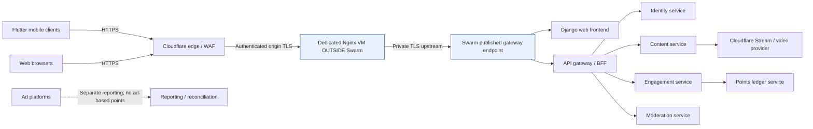
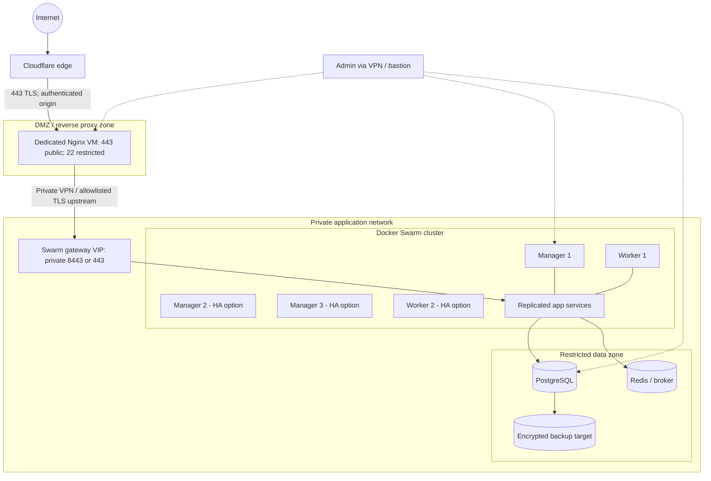
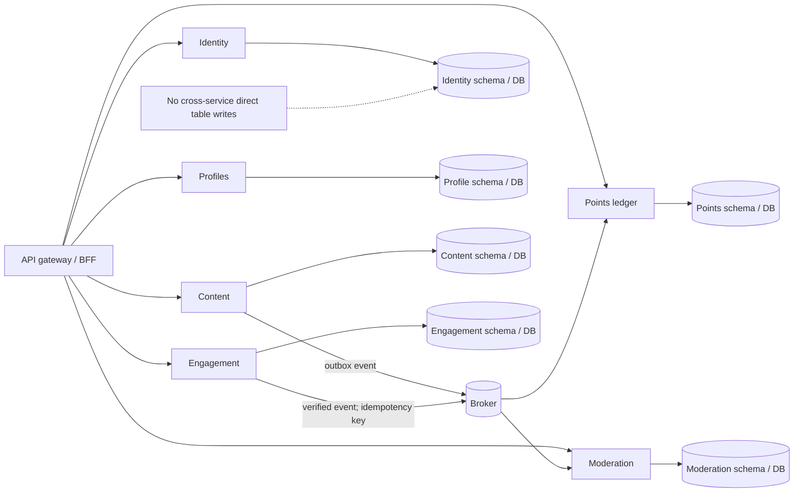
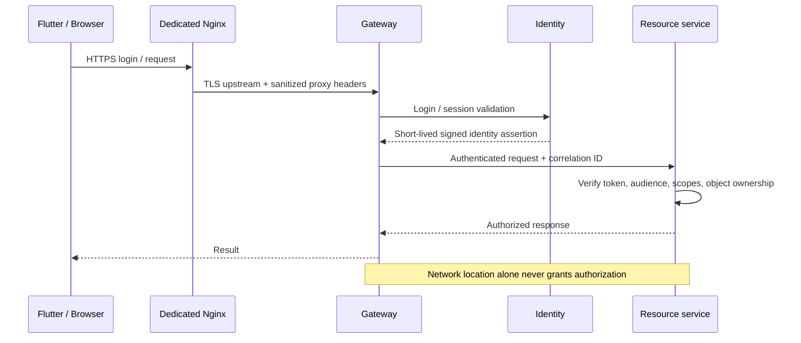
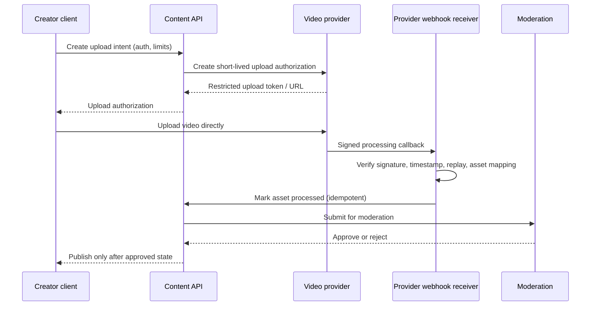
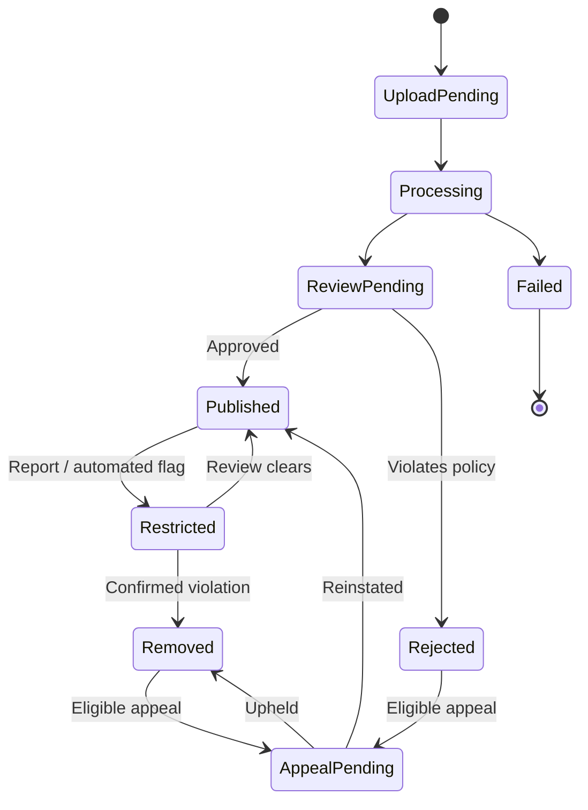
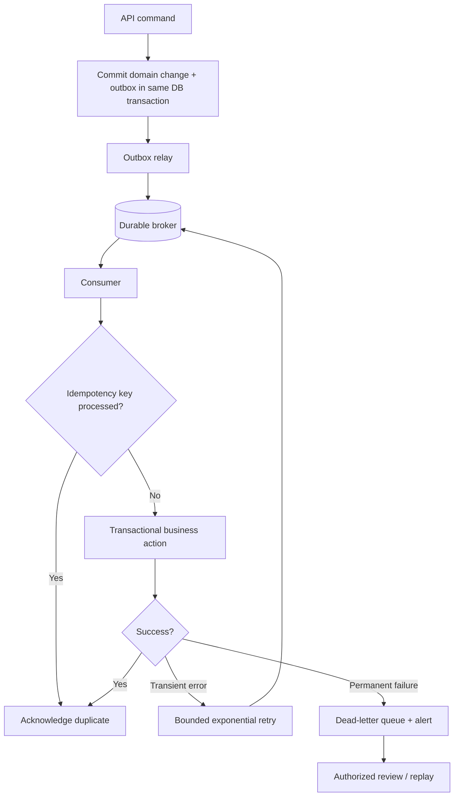
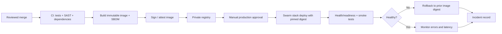
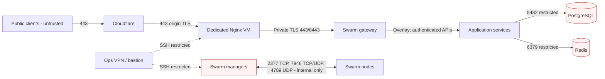
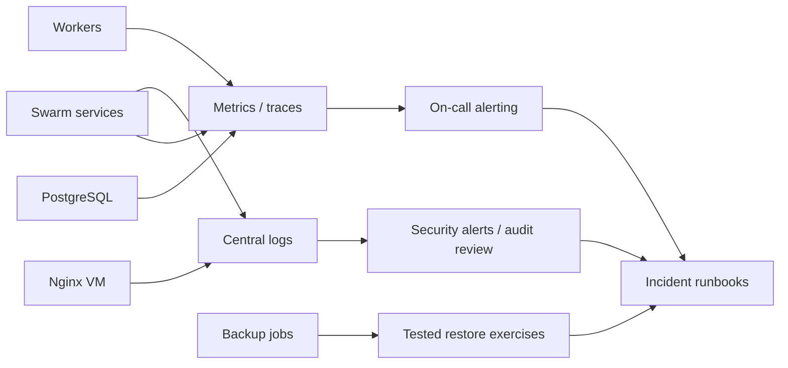

# DOC-202 — Complete Architecture and Data-Flow Diagrams
Version 1.0 · FULL REVIEW DRAFT · 28 October 2026

**Baseline:** Approved DOC-201 v1.0. Microservices deployed in Docker Swarm. Nginx on a separate server/VM outside Swarm (DEC-004). No production deployment or validation is claimed.

## Diagram register

### DFD-01: System context and external trust boundaries



**Design notes:** External requests enter via Cloudflare, then the dedicated Nginx VM. Only approved public routes are forwarded into the Swarm cluster. Provider webhooks require signature validation and replay protection.

### DFD-02: Physical deployment and network zones



**Design notes:** Node counts are deployment options, not confirmed inventory. Three managers are recommended for manager quorum in production HA. Never expose PostgreSQL, Redis, or Docker daemon publicly.

### DFD-03: Service ownership and communications



**Design notes:** Logical ownership is per service. A shared physical PostgreSQL instance may be used initially with separate databases or schemas, separate credentials and no cross-service write access.

### DFD-04: Identity, authorization and service trust



**Design notes:** Browser sessions should use secure HttpOnly cookies and CSRF protection; mobile access may use short-lived tokens and secure refresh-token rotation. Final identity protocol and key management require DOC-205/207 decisions.

### DFD-05: Video upload, processing and publication



**Design notes:** Untrusted uploads never become publicly discoverable until processing, ownership verification, and moderation checks pass. Avoid sending raw video through Nginx/Django unless a fallback is explicitly designed.

### DFD-06: Playback authorization and telemetry

```mermaid
sequenceDiagram
  participant V as Viewer
  participant A as Content API
  participant P as Stream provider
  participant E as Engagement API
  V->>A: Request video
  A->>A: Check visibility, bans, age policy
  A-->>V: Playback token / manifest authorization
  V->>P: Fetch segments with authorized playback
  V->>E: Signed session telemetry, bounded intervals
  E->>E: Rate-limit; deduplicate; assess genuine activity
  E-->>V: Acknowledge event (not a points promise)
```

**Design notes:** Client telemetry is untrusted. Playback authorization, eligibility windows, device/session abuse signals, and independent server checks are required; exact qualified-view thresholds remain an open business decision.

### DFD-07: Qualified engagement and non-cash points ledger

```mermaid
sequenceDiagram
  participant C as Client
  participant E as Engagement service
  participant DB as Engagement DB
  participant B as Durable event broker
  participant L as Points ledger service
  participant LD as Points DB
  C->>E: View / like event with session context
  E->>E: Validate account, rate, time, fraud signals
  E->>DB: Persist event + decision + outbox atomically
  DB-->>B: Publish verified engagement via outbox relay
  B->>L: Verified event + unique idempotency key
  L->>LD: Insert immutable non-cash ledger entry once
  L-->>B: Ack only after durable commit
  Note over E,L: Ad views/clicks NEVER create reward events
  Note over L,LD: Reversal is compensating entry; no destructive edit
```

**Design notes:** Ledger rules must remain server-owned, auditable and replay-safe. Pending points formulas and qualification criteria must be resolved before enabling awards. No payout functionality in Release 1.

### DFD-08: Moderation and appeal lifecycle



**Design notes:** Moderation decisions require role checks, reason codes, timestamps and audit trails. Content availability and engagement eligibility must react consistently to takedowns and reversals.

### DFD-09: Asynchronous reliability and recovery



**Design notes:** This is an at-least-once delivery model with idempotent consumers, not exactly-once delivery. Retries and dead-letter processing require monitoring and access control.

### DFD-10: Swarm rollout and rollback



**Design notes:** Schema changes must be backward-compatible across rolling updates. Database rollback is not assumed; use expand/migrate/contract and tested recovery procedures.

### DFD-11: Security trust zones and permitted flows



**Design notes:** Port numbers are reference defaults and must be validated against actual Swarm overlay encryption, private networking and chosen reverse-proxy implementation. Docker published ports may bypass host firewall assumptions; test actual rules.

### DFD-12: Audit, metrics and operational telemetry



**Design notes:** Correlate requests across services using non-sensitive trace IDs. Mask tokens and personal information. Audit trails require retention, tamper resistance and access policies to be decided.

## Assumptions, open decisions and verification gates

- **INF-01:** Confirm single-node pilot versus three-manager production quorum and worker count; diagrams show options rather than purchased infrastructure.
- **INF-02:** Confirm Nginx-to-Swarm private connectivity (VPN, private VLAN or dedicated private network), routing endpoint and upstream mTLS feasibility.
- **INF-03:** Confirm Cloudflare TLS mode, origin authentication, proxy header allowlist and client-IP trust chain.
- **INF-04:** Confirm PostgreSQL topology, backup location, replication, encryption, RPO/RTO and service credential isolation.
- **INF-05:** Confirm broker technology and durable queue/outbox operational policy; Redis alone is not a guarantee of durable event delivery.
- **SEC-01:** Complete threat model (DOC-203) for each crossing; approve secrets management, identity issuer, service-to-service authentication and logging retention.
- **BIZ-01:** Finalize qualified-view rules and non-cash points calculation before awarding points.
- **OPS-01:** Validate firewall rules from the actual Nginx VM and all Swarm hosts, including published port exposure, node failover and rollback.
- **OPS-02:** Test restore, service degradation, queue replay, moderation takedown and ledger reversals.

## Release boundaries

R1 enables identity, profiles, creator content, streaming, moderation, verified engagement and non-cash points. R2 business verification/reviews, R3 ticketing/payment and R4 real-money settlement/payouts are **excluded** from live R1 topology and may only be added after separate design and security approvals.

## Review / sign-off

DOC-202 is submitted as a **full draft for review**. It does not authorize production deployment. Reviewer: __________  Date: __________  Decision: Approve / Changes required. Subsequent updates to approved DOC-201 must be separately controlled.