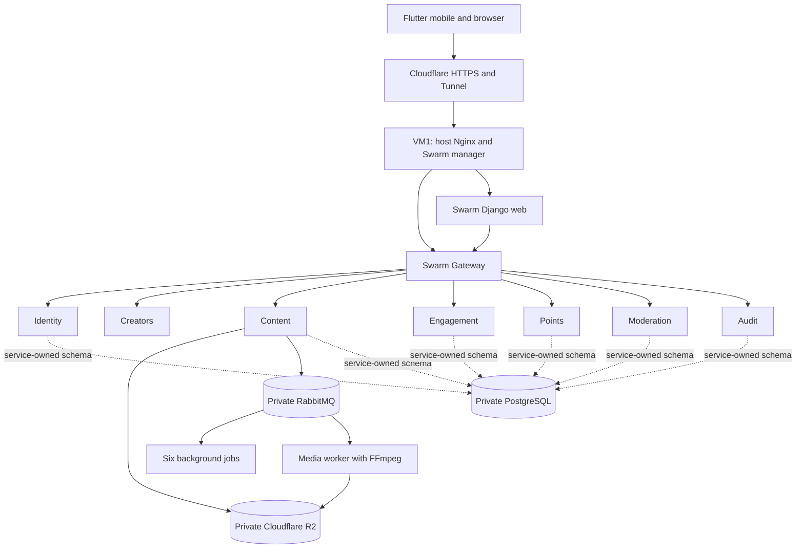

# KoloVibe R1 — AWS staging as-built reconciliation (23 November 2026)

**Status:** implementation-observed staging topology and architecture-drift record. **Not** a change to the approved R1 product scope, a production-ready HA claim, or approval of unresolved security/transport decisions.

**Current release evidence:** [v0.357.1 AWS reconciliation](../operations/R1_AWS_Staging_Reconciliation_2026-11-23.md). **Formal decision sources:** [DOC-207 ADR register](DOC-207_ADR_Register.csv), [open decision log](DOC-207_Open_Decision_Log.csv), [DEC-001 register](../requirements/platform_documentation_register_and_DEC001.md), and the [2026-11-01 Oracle-era amendment](ADR-003_007_Implementation_Reconciliation_2026-11-01.md). Historical DOC-201/202/208/209 diagrams or exports may depict a dedicated Nginx VM, a three-manager Swarm HA target, Redis/Celery or a managed video provider; **those are not the observed AWS staging configuration**.

## Actual AWS staging operating layout

| Component | Observed/stated implementation | Qualification |
| --- | --- | --- |
| Environment | Two AWS virtual machines: VM1 Docker Swarm **manager**, VM2 **worker** | This is restricted staging, not a three-manager high-availability control plane |
| Edge | Cloudflare HTTPS/DNS/Tunnel, then **host-installed Nginx on VM1** | Nginx is not a Swarm Nginx service; origin-bypass, upstream transport, and trusted-header evidence still need dedicated checks |
| Clients | Django server-rendered web at `kolovibe.cabetechs.shop`; mobile API publicly smoke-tested at `mobile-api.cabetechs.shop` | Older host references, such as `api.cabetechs.shop`, must not be assumed equivalent without routing verification |
| API | **Eight** Swarm services: Gateway, Identity, Creators, Content, Engagement, Points, Moderation, Audit | Exact digest-pinned release v0.357.1; independent acceptance varies by feature |
| Background workloads | **Six** separate shared-image jobs/consumers plus **one** media worker | Running 1/1 at rollout verification; running containers alone do not prove queue/retry/replay correctness |
| Web | **One** separately image-pinned Django web Swarm service | Browser console has privileged MFA gate and same-origin QR enrollment implementation |
| Database | Private PostgreSQL, service schemas and roles; **17.11** reported in 22 Nov preflight | Ownership/least privilege and backup restore are open |
| Messaging | **RabbitMQ** private broker with Celery/job consumers; PostgreSQL remains authoritative for business data | No Redis dependency should be introduced as the intended broker; retry/DLQ/recovery acceptance open |
| Video | **Private Cloudflare R2 objects and FFmpeg VOD encoding**, with authorized publication/playback policies | Live end-to-end signed upload, transcode, replay/expiry and physical-device playback not yet accepted |
| Security boundaries | Private Swarm services/messaging/data zones, service-signed internal calls, scoped credentials and secrets | Confirm current service-to-service ACLs, connectivity and origin isolation independently |

### Diagram — implementation shape, not a verified packet-capture

The arrows show architectural relationships only; they do **not** certify network policies, TLS/mTLS on individual hops, or live broker and R2 transactions. Nodes or container placement must be rechecked from actual Swarm inspections before any HA/capacity decision.

## Reconciling formal baselines and implementation amendments

| Reference | As-built clarification and required control |
| --- | --- |
| ADR-001/002 | Independent Django microservices and Docker Swarm are the deployed staging model; eight APIs plus workers and web, two VMs with single manager; no HA claim |
| ADR-003 | The 1 Nov amendment put host Nginx on Oracle VM1. This **placement model** persists, but the current environment is **AWS**. Historical Oracle deployment records stay separately labeled; document AWS location as an environment migration and review the formal ADR/infrastructure text under architecture change control |
| ADR-007 | **RabbitMQ/Celery**, not Redis; PostgreSQL-backed durable events, idempotency, retry/outage semantics still require live acceptance |
| ADR-008 / OD-07 | The earlier managed-provider VOD ADR was superseded for R1: **Cloudflare R2 + FFmpeg worker** for private VOD; live streaming deferred |
| ADR-009 / DEC-003 | Server-qualified views and **non-cash** points are approved policy, but live awards and reversal acceptance are not inferred from running containers |
| ADR-010 / DEC-001 | No R1 business discovery, event ticketing, cash payout or live streaming; do not expand scope by documenting future possibilities as deployed features |
| ADR-012/013/014 | Identity/MFA design approval is distinct from service identity, upstream TLS and privileged session negative-test acceptance. The administrator/reviewer six-case owner UAT is positive evidence only |
| DOC-201/202/208/209 | Preserve original historical and approved-source content for provenance. Link to this as-built addendum in current indexes; formal owner-reviewed revision of outdated provider/topology diagrams remains a **separate document-control task**, not a silent rewrite |

## Operational security deltas and open decisions

1. **Single-manager/VM1 ingress concentration:** VM1 loss affects both Swarm manager and host Nginx; set recovery targets, reserve capacity, restrict direct origin/control-plane ingress and exercise recovery.
2. **PostgreSQL permissions:** 23 November catalog output showed **26 runtime-role-owned tables and eight runtime-role-owned sequences**. Inspect role inheritance, login credentials, role-set privileges, DDL grants, default grants and service migrations before any reownership. The presence of ownership is a least-privilege concern, not proof of exploitation.
3. **Backup/restore:** Image deployments were explicitly conducted without an advance backup at owner direction. This is a staging-risk choice, **not** a production backup or recoverability gate pass.
4. **Reviewer authorization:** Moderator permissions are assignment-scoped; zero active grants previously yielded restricted 403s; administrator and assigned moderator positive journeys were owner-reported PASS on v0.357.1. Test unauthorized access to unassigned items independently.
5. **Monitoring, rate limiting, audit event retention and evidence:** CI, health probes and the six successful privileged web UAT checks do not independently establish negative authorization, event delivery, retention, abuse resistance or business transaction correctness.
6. **Source/deployed divergence:** At inspection, repository `main` was ahead of deployed commit `807b1edc`, adding creator-admin and identity lookup work. Keep those source changes staged for their own CI/release/UAT, not a retroactive v0.357.1 deployment claim.

**Change-control action:** reconcile DOC-207/208/209 and the open decisions with this AWS topology and observed risks through owner review; do not change their historical approval dates or infer missing sign-off. The [readiness gates](../planning/go_live_readiness.md) remain **NO-GO** for production.
