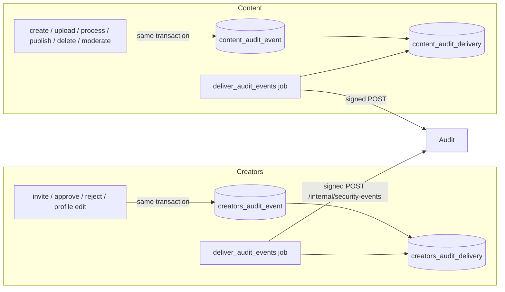

# R1 completion design — approved requirements still unbuilt

**Status: PROPOSED. Not approved, not implemented.** 25 November 2026, reverification Phase 2. Base: `main` at `8a6e7a0`. This is the design package for the **Release 1** work that [Phase 1](../engineering/reverification/Phase1_Reverification_2026-11-25.md) found missing or partial. Later-release modules already have complete proposed packages (section 10) and are not redesigned here.

Each slice states its requirement, whether it needs a decision first, the design, the data and API changes, authorization, threats, retention, dependencies and acceptance criteria. **Slices marked "Approved requirement, no policy needed" can be built once the owner authorizes Phase 3; nothing here authorizes deployment.**

## 0. Slice summary

| Slice | Requirement | Decision needed before code? | Decision needed before deploy |
| --- | --- | --- | --- |
| S1 Creators and Content audit delivery | FR-015, PRD-F10 | No. Audit already accepts both producers and their event kinds (`services/audit/service/events.py`) | D11-007 / O-10 credentials and peer keys |
| S2 Broker dead-letter handling | NFR-013 | Retry ceiling and DLQ retention values (RV2-03) | O-9 broker read-back |
| S3 Scheduled maintenance roles | NFR (row growth), P3-01 | No | O-12 scheduling approval |
| S4 Poster re-render after a cover edit (defect D-P2-01) | FR-006/007, M-054 | No | none beyond a normal release |
| S5 Upload result screens M-050, M-051, M-052 | PRD-F04, approved designs | No | none |
| S6 Consent and policy-acceptance record | NFR-012, PRD-F09 | Terms and privacy notice text (#165) and version scheme (RV2-02) | Legal sign-off |
| S7 Privacy access and deletion processing | FR-017, PRD-F09 | **ADR-020** (retention, deletion, residency) | ADR-020 and legal |
| S8 Observability | FR-019 | **ADR-017 / OD-08 / INF-09** stack choice | Same |
| S9 Database backup and restore tooling | NFR-008 | **ADR-016 / OD-04 / INF-05 / INF-10** | Same |
| S10 Published-video edit re-review | FR-006 | **RV2-01** policy | none |
| S11 Copyright claimant intake | Copyright pipeline | **D11-008** channel; copyright policy legal review | Legal |
| S12 Creator restriction write path | PRD-F08, D-8 | **D-8** grounds and authority | none |

## 1. Architecture conformance (checked against code on `8a6e7a0`)

| Rule | Evidence | Result |
| --- | --- | --- |
| Flutter for every ordinary user | `apps/mobile` serves viewer, creator, customer, business owner and staff; no other client exists | Conforms |
| Django web only for administrators and moderators | `apps/web_django/web/views.py` `privileged` decorator (session, live Identity check, privileged role, `mfa_verified`); root redirects to login; `test_route_security_matrix.py` refuses a `viewer` on every route | Conforms. The older tracker rows that describe a public web feed are historical |
| Server-side authorization | Gateway default-deny route table; services re-check ownership; Flutter visibility is cosmetic | Conforms |
| Microservice database ownership | each service sets `database_options("<service>")` (own schema and login); no cross-service model import; references are plain UUIDs; isolation proven by `scripts/test_postgres_foundations.py` | Conforms |
| Secure Gateway reused | 82 Gateway routes, signed internal envelopes, per-peer keys | Conforms |
| RabbitMQ for approved async flows | Engagement→Points (Celery over AMQPS), media processing | Conforms; **no dead-letter path** (S2) |
| R2 + FFmpeg for VOD | Content storage and media worker (FFmpeg 9.1) | Conforms; real R2 unproven (B5) |
| Safe schema migrations | migration login separate from runtime (D11-002 fix), `makemigrations --check` in CI, apply/reverse/re-apply test | Conforms in the repository; staging not converted (B1) |
| No duplicate monetary ledger | no money code exists. Phase 7 (DR-EV-03) and Phase 8 (DR-AD-03) proposals conflict with Phase 9 (DR-FIN-02); Phase 9 recommends one Finance ledger | **Conflict to resolve by decision** (approval register, X-01) |
| Fits the infrastructure | AWS two-VM staging runs nine services and seven worker roles; a tenth (Events/Ads/Finance) is unmeasured (DR-BZ-24, DR-EV-07) | **Capacity dependency recorded**, O-13 |
| No public website, no live streaming | none in code | Conforms |

## 2. S1 — Creators and Content audit delivery

**Design.** Reuse the Points/Moderation pattern exactly: an append-only `AuditEvent` written **in the same transaction** as the change, a one-to-one `AuditDelivery` row, and a `deliver_audit_events` management command that posts signed batches to Audit's `/internal/security-events` with bounded backoff. Creators' existing `OnboardingEvent` stays (it is local evidence); the new `AuditEvent` is written next to it.

**Data.** Two tables per service, identical to `points_audit_event`/`points_audit_delivery`: `id uuid`, `kind varchar(64)`, `actor_id uuid null`, `occurred_at`, `subject_type`, `subject_id uuid`; delivery `attempts`, `delivered_at`, `next_attempt_at`. An append-only trigger on the event table (as Points). One migration per service; reversible.

**Event kinds.** Only those Audit already accepts: `creator.invited`, `creator.application_submitted`, `creator.approved`, `creator.rejected`, `creator.profile_updated` (and `creator.restricted/suspended/restored` once S12 exists); `video.created`, `video.updated`, `video.upload_intent_created`, `video.upload_completed`, `video.processing_succeeded`, `video.processing_failed`, `video.deleted`, `video.published`, `video.unpublished`, `video.moderated`.

**API.** No public change. Internal delivery uses the existing Audit endpoint. **Swarm:** `creators-audit` and `content-audit` roles (`--role deliver-audit`) mirroring `points-audit`.

**Authorization and threats.** Spoofing: per-peer signing key, Audit's producer allow-list already names both. Tampering: append-only trigger, owner/runtime split. Repudiation: closed by this slice. Information disclosure: ids and codes only, no titles, descriptions, emails or reasons. DoS: bounded batch (1–1000), backoff.

**Retention.** Producer rows kept until delivered; delivered rows follow the same rule as Points (no purge until OD-08/ADR-017 sets audit retention).

**Acceptance.** (1) Each listed action writes exactly one event in its transaction; a rolled-back action writes none (test). (2) UPDATE/DELETE on the event table fails for the runtime login on PostgreSQL. (3) Delivery is idempotent across a crash between POST and commit. (4) Audit rejects a kind not in the list. (5) The console audit page shows `creators` and `content` producers. (6) No payload contains personal text (static test on the serializer).

## 3. S2 — Broker dead-letter handling

**Design.** For `kolovibe.points` and the media queue: declare a per-queue dead-letter exchange `kolovibe.dlx` and queue `<queue>.dead` with `x-dead-letter-exchange` on the work queue; the poison-message guard (D11-001) **rejects without requeue** so the broker moves the message; transient database errors keep the existing retry but with a **finite ceiling** (today `max_retries=None`). Add a counted, read-only console figure for dead letters (no message bodies shown). Declarations come from the existing broker generator so the least-privilege accounts get `configure` only on their own names.

**Values needed (RV2-03).** Retry ceiling, DLQ message TTL and maximum length, who may replay and how. Until decided, development uses configuration with no default that silently drops.

**Threats.** Tampering: replay is an administrator operation through the normal publish path, never a raw broker write. DoS: max-length on the DLQ. Disclosure: payloads are ids only.

**Acceptance.** A malformed envelope lands in `.dead` (real-broker test); a valid message after the poison one is processed; retries stop at the ceiling and then dead-letter; the generator grants no wildcard.

## 4. S3 — Scheduled maintenance roles

**Design.** Three Swarm roles using the existing `--interval` runner: `identity-purge` (`purge_expired_security_rows --limit 5000`, daily), `web-purge` (`purge_expired_web_sessions` + `clearsessions`, daily), `content-requeue` (`requeue_stalled_media --limit 100 --stalled-minutes 15`, every 15 minutes). Runtime credentials only, `replicas: 0` in the candidate stack until O-12. Counts-only logging (runbook rule 3).

**Acceptance.** `scripts/test_infra_deployment_contracts.py` extended: each role exists, uses the service's runtime secret, has resource limits and no owner credential; the rendered stack validates.

## 5. S4 — Poster re-render after a cover edit (defect D-P2-01, found in Phase 2)

**Finding.** `PATCH /videos/{id}` with a new `cover_time_ms` on a processed video sets `poster_asset_id = None` "deferred" to a re-render (`services/content/service/media_api.py:169`), but **nothing re-renders it**: `render_poster` is called only from `media_processing.process`. A creator who moves the cover on a published video loses the poster permanently.

**Design.** Publish a `kolovibe.media.poster` task after commit; the media worker renders from the stored rendition under the existing lease and writes the new poster id; the old poster object is kept until S-retention (OD-07) allows deletion. The video stays playable throughout.

**Acceptance.** Cover edit → task queued once (idempotency key = video id + revision); worker sets a new poster; a lost task is recovered by `requeue_stalled_media` extended to poster-less processed videos; playback never interrupted.

## 6. S5 — Upload result screens M-050, M-051, M-052

**Design.** No API change. `GET /videos/{id}/upload-status` and the owned-video read already return `review`, `published`, `rejected`. After M-049 resolves, route to M-050 (in review), M-051 (published, with View and Share) or M-052 (rejected, showing the server's notice link to M-057/M-078). Reuse `LiveCreateOriginalScreen` states and system widgets; no new repository.

**Acceptance.** Widget tests for each state reached from a scripted repository; design audit at 390×844 and 375×667, text 1× and 2×; the route probe no longer resolves M-050–052 to a static recipe; rejected state never shows a reason the server did not send.

## 7. S6 — Consent and policy-acceptance record (needs RV2-02 and #165)

**Finding.** Identity stores notification preferences only; registration records no acceptance of terms or the privacy notice (NFR-012 "log consent").

**Design (proposed).** Identity `PolicyAcceptance(account_id, document, version, accepted_at, channel)`, append-only; registration requires the current version; a new version prompts on next sign-in; withdrawal of optional consents (notifications today) is recorded the same way. Flutter shows the current text from a versioned, bundled document id.

**Blocked until:** the text and version scheme exist (legal). Code can be prepared behind a flag.

## 8. S7 — Privacy access and deletion processing (needs ADR-020)

**Today.** `PrivacyRequest` is a receipt with status `received`, never changed.

**Proposed design (for the ADR-020 decision, not for build).** Identity orchestrates: an administrator claims a request in the console (MFA, step-up once DR-BZ-33 exists); Identity calls each service's internal `privacy/export` and `privacy/erase` operation with the account id; each service returns its own data or performs its own erasure/anonymisation, honouring legal holds (financial and audit records are never erased, only de-linked as ADR-020 decides); Identity assembles the export for in-app download (no email link: DR-BZ-28 position), records each step and closes the request. Retention table per data category is an ADR-020 output.

**Blocks:** FR-017 completion, BZ-R-039/040, DR-EV-30, DR-FIN-08 retention.

## 9. S8, S9, S10, S11, S12 — decision-first slices

| Slice | What the decision must say | Then the build is |
| --- | --- | --- |
| S8 Observability (ADR-017, OD-08, INF-09) | Stack (self-hosted vs managed), log retention, redaction rules, alert recipients | JSON logs with request ids, shipping agent role, metrics for queue depth/DLQ/5xx/latency, alert rules, a redaction test |
| S9 Backup and restore (ADR-016, OD-04, INF-05, INF-10) | Topology, RPO/RTO, encryption key owner, retention | Scheduled encrypted `pg_dump`/base backup to private storage, restore-into-scratch job with row-count comparison (extends `T10_30`), monthly drill record |
| S10 Published-video edit re-review (RV2-01) | Whether title/description/category/tag edits to a **published** video go back to review (today they publish immediately, `media_api.py:177`) | If yes: material edits create a pending revision; the approved revision stays live |
| S11 Copyright claimant intake (D11-008) | Channel (in-app form for signed-in claimants, console entry by an administrator, or both); identity proof; counter-notice flow per the draft policy | Report kind `copyright_claim` reusing Moderation workflow and the existing Content copyright pipeline |
| S12 Creator restriction (D-8) | Grounds, durations, who may restrict and restore, notice and appeal | Moderation decision type writing Creators status, with S1 audit events |

## 10. Later-release design packages (already complete, all PROPOSED)

| Module | Requirements | ADR | ERD | API | RBAC/BOLA | STRIDE | Retention | Delivery and acceptance |
| --- | --- | --- | --- | --- | --- | --- | --- | --- |
| Business (R2, built dark) | `docs/requirements/BIZ-Requirements_Reconciliation_PHASE6A.md` | `docs/adr/ADR-BIZ-001…` (approved as written) | `docs/architecture/business/BIZ-ERD_PROPOSED.md` | DOC-205 (reconciled) | `docs/security/phase6/BIZ-RBAC_and_Object_Authorization_Matrix_PROPOSED.md` | `docs/security/phase6/BIZ-STRIDE_Threat_Model_PROPOSED.md` | `docs/privacy/business-data-privacy-and-retention-PROPOSED.md` | Phase 6E results |
| Events and ticketing (R3) | `docs/requirements/EVT-Requirements_PRD_SRS_PROPOSED.md` | `docs/adr/ADR-EVT-001…` | `docs/architecture/events/EVT-ERD_PROPOSED.md` | `EVT-API_Contract_PROPOSED.md` | `docs/security/phase7/EVT-Authorization_Matrix_PROPOSED.md` | `docs/security/phase7/EVT-STRIDE_Threat_Model_PROPOSED.md` | `EVT-Payment_and_Refund_Policy_PROPOSED.md` (DR-EV-30 open) | `docs/engineering/phase7/EVT-Acceptance_and_Delivery_Plan_PROPOSED.md` |
| Advertising | `docs/requirements/AD-Requirements_PRD_SRS_PROPOSED.md` | `docs/adr/ADR-AD-001…` | `docs/architecture/advertising/AD-ERD_and_State_Machines_PROPOSED.md` | `AD-API_Contract_PROPOSED.md` | `docs/security/phase8/AD-Authorization_Model_and_Matrix_PROPOSED.md` | `docs/security/phase8/AD-STRIDE_Threat_Model_PROPOSED.md` | `AD-Policies_PROPOSED.md` | `docs/engineering/phase8/AD-Acceptance_and_Delivery_Plan_PROPOSED.md` |
| Revenue and finance (R4) | `docs/requirements/FIN-Requirements_PRD_SRS_PROPOSED.md` | `docs/adr/ADR-FIN-001…` | `docs/architecture/finance/FIN-ERD_and_State_Machines_PROPOSED.md` | `FIN-API_Contract_PROPOSED.md` | `docs/security/phase9/FIN-Control_Model_and_Authorization_Matrix_PROPOSED.md` | `docs/security/phase9/FIN-STRIDE_Threat_Model_PROPOSED.md` | DR-FIN-08 (supply) | `docs/engineering/phase9/FIN-Acceptance_Correctness_and_Delivery_Plan_PROPOSED.md` |

## 11. RBAC and object-level rules for S1 to S7

| Operation | Caller | Rule |
| --- | --- | --- |
| Write audit event | owning service only | in-transaction, no API |
| Deliver audit event | the service's delivery role | signed with its own peer key; Audit checks producer and kind |
| Read creators/content audit | administrator (MFA) with an Audit read grant | existing `AuditReadGrant`, producer-scoped |
| Dead-letter count | administrator (MFA) | count only; replay is a separate decision |
| Maintenance jobs | job role, runtime login | no owner or migration privilege |
| Poster re-render | media worker | lease-guarded; video owner unchanged |
| M-050–052 | the video's creator | owned-video read already returns 404 to anyone else |
| Policy acceptance | the signed-in account for itself | append-only; administrators read counts only |
| Privacy processing (proposed) | administrator (MFA, step-up) claims; services act on their own data | requester never sees another account; holds override erasure |
