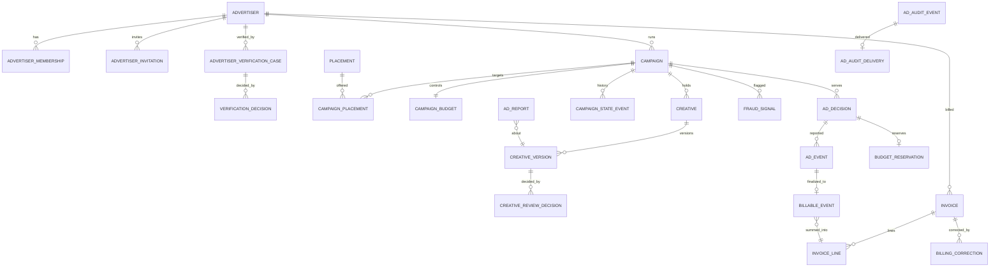
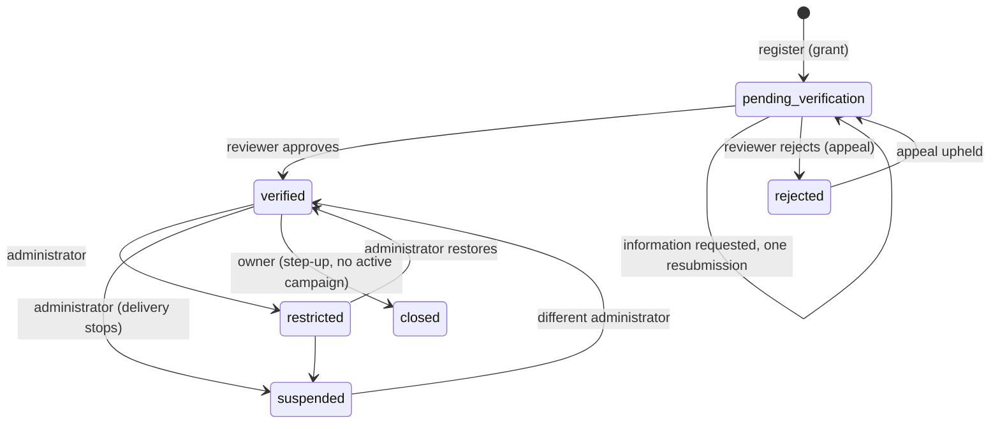
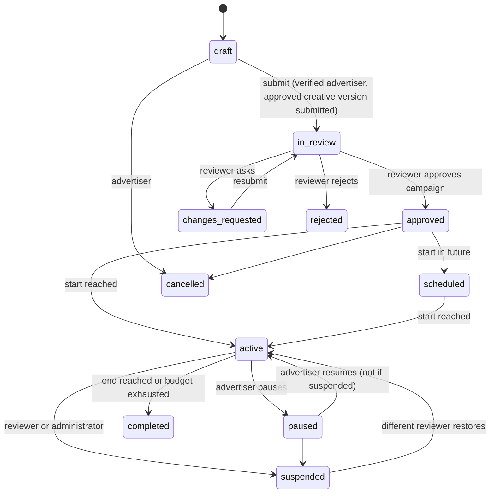
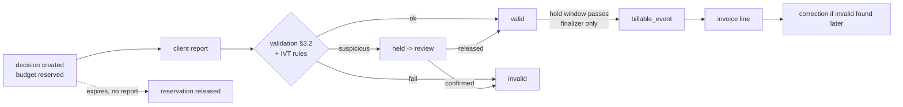

# Ads service database ERD and state machines (proposed)

**Status: PROPOSED — illustrative design, not DDL. No migration is created or implied by Phase 8A.** 25 November 2026. Conventions follow [DOC-204](../DOC-204_ERD.mmd) and the [Business ERD](../business/BIZ-ERD_PROPOSED.md): UUID keys, cross-service references are plain UUID columns with **no foreign keys**, own schema (`ads`). Money: `bigint` minor units plus currency; per-impression cost in `bigint` micro-minor units.

## 1. Diagram

External ids appear only as UUID columns: `account_id` (Identity), `business_id` (Business, association). The service stores no names, emails or phones of viewers.

## 2. Tables and key columns

### Advertisers (A1)

| Table | Key columns | Notes |
| --- | --- | --- |
| `advertiser` | id, display_name, status, business_id (nullable), business_link_state, currency, created_by_account_id, version | Status server-only |
| `advertiser_registration_grant` | id, account_id, granted_by, expires_at, used_at | Invitation-only |
| `advertiser_membership` | id, advertiser_id, account_id, role (`owner`/`manager`/`analyst`), status | Unique active `(advertiser_id, account_id)`; the one authorization predicate |
| `advertiser_invitation` | id, advertiser_id, role, code_hash, expires_at, redeemed_by | Hashed, single use |
| `advertiser_verification_case` / `verification_decision` | state, round, valid_until / reviewer_id, decision, reason_code | Decisions append-only |
| `reviewer_grant` | account_id, scope (`advertiser_review`/`ad_review`/`ad_fraud`/`ad_billing`), granted_by, revoked_at | Moderators and administrators only |

### Campaigns and creatives (A2, A3)

| Table | Key columns | Notes |
| --- | --- | --- |
| `placement` | id, key (`feed_native`, `explore_native`), approved, density config | Administrator-managed |
| `campaign` | id, advertiser_id, name, state, starts_at, ends_at, county_filter, category_filter, current_creative_version_id, version | Targeting limited to contextual columns |
| `campaign_placement` | campaign_id, placement_id | |
| `campaign_budget` | campaign_id, currency, total_minor, daily_minor, price_per_mille_minor, spent_micros, reserved_micros, day_spent_micros, day | `CHECK (spent_micros + reserved_micros <= total_minor * 1e6)` and the daily equivalent |
| `campaign_state_event` | id, campaign_id, from, to, actor_id, reason_code, at | Append-only |
| `creative` / `creative_version` | creative_id; version_no, state, headline, body, cta_code, destination_kind, destination_ref, destination_host, media_ref (null until pipeline), submitted_at | **Immutable once submitted**; unique `(creative_id, version_no)` |
| `creative_review_decision` | id, version_id, reviewer_id, decision, reason_code, at | Append-only |

### Delivery and measurement (A4, A5)

| Table | Key columns | Notes |
| --- | --- | --- |
| `ad_decision` | id (random 128-bit), account_id, campaign_id, creative_version_id, placement_id, issued_at, expires_at, unit_cost_micros, status | Server-created only |
| `ad_event` | id, decision_id, kind (`impression`/`click`), reported_at, server_received_at, visible_ms, outcome (`valid`/`invalid`/`held`/`duplicate`), reason_code | **Unique `(decision_id, kind)`** among non-duplicates; duplicates recorded in a counter table, not as rows, to bound growth |
| `budget_reservation` | decision_id (unique), campaign_id, cost_micros, state (`held`/`settled`/`released`) | Created in the decision transaction |
| `billable_event` | id, ad_event_id (unique), decision_id, kind, campaign_id, creative_version_id, cost_micros, price_snapshot, created_at | **Append-only; unique `(decision_id, kind)`**; written only by the finalizer |
| `frequency_counter` | account_id, campaign_id, day, count | Short retention; the only per-account behavioural state |
| `network_hash_window` | keyed_hash, window_start, counts | 30-day retention; fraud rules only |
| `fraud_signal` | id, campaign_id, rule, score, state, reviewed_by | Evidence only |
| `ad_report` | id, reporter_account_id, creative_version_id, reason_code, state | Report this ad |
| `ad_event_rejection_counter` | day, reason, count | Monitoring without storing rejected payloads |

### Billing preparation (A7)

| Table | Key columns | Notes |
| --- | --- | --- |
| `invoice` | id, advertiser_id, number (unique), period, state, currency, total_minor | Total is derived; recomputable |
| `invoice_line` | id, invoice_id, campaign_id, placement_id, quantity, amount_minor | One rounding per line |
| `billing_correction` | id, invoice_id, kind (`credit`/`debit`), amount_minor, reason_code, requested_by, approved_by, second_approver | Append-only |
| `recon_difference` | id, period, source, expected_minor, actual_minor, state | Never auto-corrected |

### Administration

`idempotency_record` (as Business), `ad_audit_event` and `ad_audit_delivery` (id-only outbox, as Business), `nonce` table for service identity (P2-01 pattern).

## 3. Integrity constraints carrying the security claims

| Claim | Constraint |
| --- | --- |
| Cannot overspend | Conditional atomic update at decision time plus `CHECK` on `campaign_budget` |
| One decision reserves once | unique `budget_reservation.decision_id` |
| Replay is a no-op | unique `(decision_id, kind)` on `ad_event` and `billable_event` |
| Client cannot invent a decision | Only server-created ids exist; id plus MAC verified |
| Creative cannot change after review | Versions immutable; delivery reads the approved version id |
| Cross-campaign access impossible | Every object query is joined to the caller's active membership |
| Invoices cannot double count | `billable_event` consumed once per invoice period (unique `(billable_event_id)` in a link table) |
| Billing history cannot be rewritten | No update or delete path; corrections only |
| No Points path | No reference to Points or Engagement anywhere |

## 4. State machines

### Advertiser

### Campaign

### Creative version

`draft → submitted → approved | changes_requested | rejected`; `approved → suspended → approved (different reviewer)`; `rejected → appealed → approved | rejected`; `approved → superseded` when a newer version is approved.

### Ad event and billing pipeline

## 5. Cross-service interactions

| Direction | Mechanism | Purpose |
| --- | --- | --- |
| Gateway → Ads | signed envelope (actor, role, MFA, verified email, **consent state**) | All client and console calls |
| Ads → Business | signed read-only internal check, if DR-AD-11 approved | "Is this account an active owner of verified business B?" |
| Ads → Audit | outbox delivery | Audit events |
| Ads ↔ Engagement, Points, Content | **none** | Separation by design |
