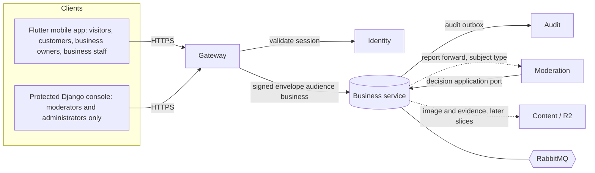
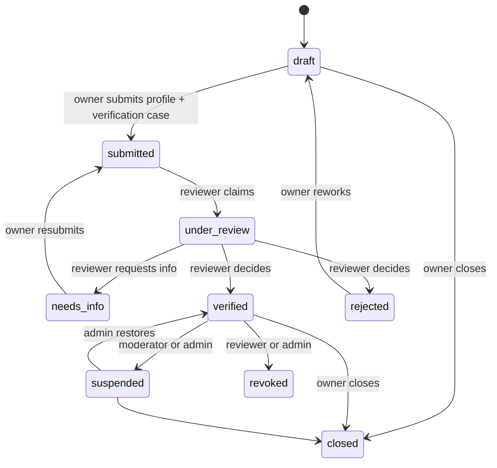
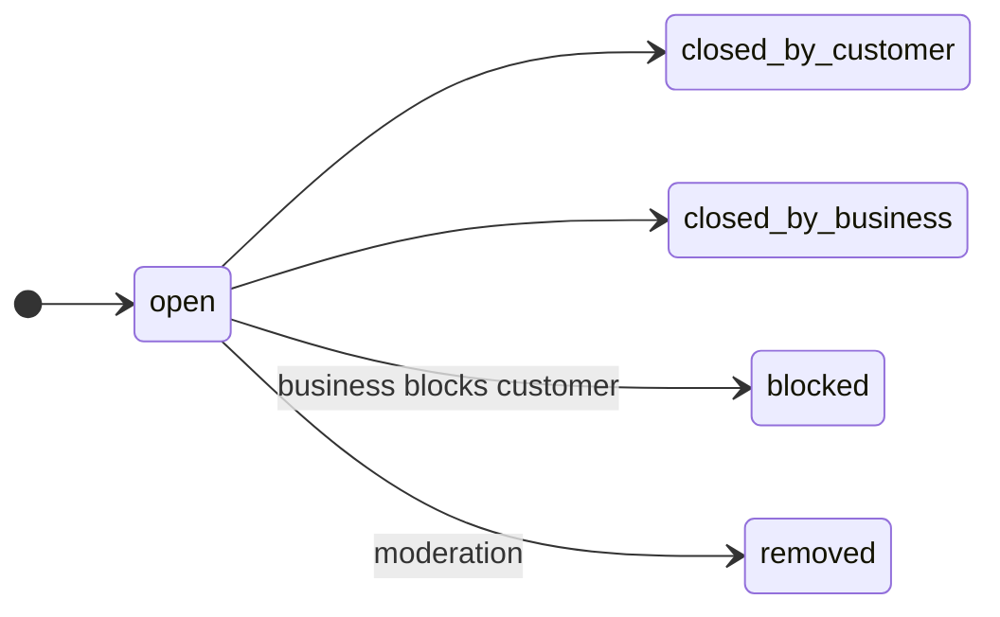
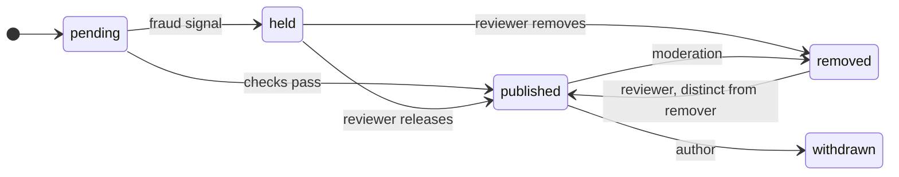
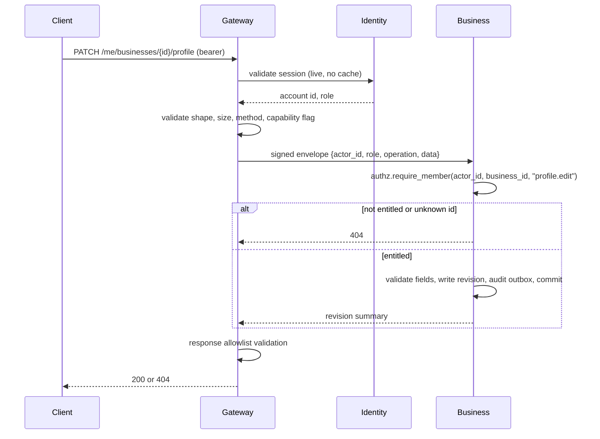

# Business service architecture

**Status: PROPOSED — Draft for owner review. Not approved; nothing is implemented.** Phase 6A, 24 November 2026. Decision basis: [ADR-BIZ-001](../../adr/ADR-BIZ-001_Business_Bounded_Context_PROPOSED.md). Requirements: [BZ-R-001…048](../../requirements/DOC-020_Business_Requirements_and_Scope_PROPOSED.md). Open policies: [decision register](BIZ-Owner_Decision_Register_PROPOSED.md).

> **Status update, 24 November 2026 (Phase 6A reconciliation).** This is supporting design for decisions the owner approved as written (DR-BZ-01…26, [approval record](BIZ-Owner_Approval_Record_2026-11-24.md)); no separate approval of this document is recorded, and the banner above is the original wording. DR-BZ-21 was decided formally (Flutter only; no public website or business portal). The backend was built in Phase 6B (PR #219, closed flags, **not deployed**; production NO-GO). Where this document and the as-built system differ, see the [architecture validation](BIZ-Architecture_Validation_PHASE6A.md); what the owner must still decide is in [owner decisions required](BIZ-Owner_Decisions_Required_PHASE6A.md).

This is design only. No migrations, code, infrastructure or AWS changes are part of Phase 6A.

## 1. Existing platform (observed at `main` 1b72139)

| Component | What exists | Reused by Business |
| --- | --- | --- |
| Gateway (`services/gateway`) | Public edge. Route modules per domain behind capability flags that are **closed by default** (`capabilities.py`); `current_account` validates every request against Identity's live session with no positive cache; privileged routes use `principal()` (moderator/administrator plus live MFA); responses re-validated against allowlists before returning; one error shape (`{"detail": …}`); route-contract and role-matrix tests. | Same pattern for new route modules and flags. |
| Identity | Django-native accounts; roles `viewer`, `creator`, `moderator`, `administrator`; sessions, refresh rotation and replay detection; MFA for privileged roles; mailbox-bound single-use invitations; `PrivacyRequest` receipts; bounded purge of expired security rows. | Authentication, role and MFA state. **Unchanged** except the step-up capability (P6B-04). |
| Creators | `CreatorProfile` (owner `user_id`, status, review fields, DB check that *active* requires review), application workflow, public search of reviewed-active profiles only, ownership resolved server-side. | Patterns only (public predicate, server-side ownership, cursor pages). Tables are not touched. |
| Moderation | Reports, actions, appeals keyed to `video_id`; `ModeratorAssignment` grants; reviewer previews; idempotent decisions with receipts; distinct-reviewer restoration; audit outbox. | Patterns and, subject to DR-BZ-17, a generalization. |
| Audit | Producer allowlist, kind allowlist, subject-type allowlist, 2048-byte cap, ids only, idempotent by event id, MFA-gated read through the gateway with redaction. | New `business` producer, kinds and subject types. |
| Content | Private R2 with size-bound create-only grants, exact-object completion, FFmpeg worker. | Pattern only; no image pipeline exists. |
| Service trust | Shared HMAC verifier (per-caller keys, 60 s timestamp window, DB nonce table, path allowlist per caller) and signer, copied identically into each service and checked by a drift test. | One more identical copy. |
| Data isolation | One PostgreSQL schema and one `_app` login per service; `internal_request_nonce`, `event_outbox`, `event_inbox` created per service by `schema_isolation.sql`. | New schema `business` and role. |

## 2. Context and boundaries



**No public website and no business web portal exist or are designed** (DR-BZ-21, decided 24 November 2026): every non-privileged Business actor uses the Flutter app and only moderators and administrators use the console. See [the client architecture](BIZ-Client_Architecture_DR-BZ-21.md). Dotted lines are conditional: the Moderation link follows DR-BZ-17, the Content link follows DR-BZ-19 and DR-BZ-20. A fuller dependency view, including delivery dependencies, is in [BIZ-Dependencies](BIZ-Dependencies_PROPOSED.md).

**Rules.** Clients reach Business only through the Gateway. Business never reads another service's tables and no other service reads Business tables. Cross-service references are UUIDs without foreign keys. The Gateway is the only caller of customer, owner and public routes; Moderation is an allowed caller only for its own decision-application path. Business has no outbound path to Identity for authentication; it trusts the gateway-signed envelope exactly as Creators and Content do.

## 3. Service layout (proposed, mirrors existing services)

```
services/business/
  manage.py
  service/__init__.py  settings.py  urls.py  health.py  service_auth.py  internal_client.py
  service/models.py              # see ERD
  service/authz.py               # the ONE membership/entitlement resolver
  service/validation.py          # allowlist field validators, text normalisation
  service/registration.py        # create business, membership, closure
  service/profiles.py            # revisions, contacts, hours, categories
  service/verification.py        # cases, evidence records, reviewer decisions
  service/listings.py            # eligibility predicate, projection writer, search
  service/inquiries.py
  service/reviews.py
  service/throttle.py            # DB-backed budgets (pattern from Identity)
  service/audit_outbox.py        # AuditEvent + AuditDelivery (pattern from Moderation)
  service/management/commands/   # deliver_audit_events, purge_* (policy-gated)
  tests/
```

`authz.py` is the single place that answers “is this account entitled to this object for this operation?”. Views never query `BusinessMembership` directly; a test enforces that.

## 4. Internal API surface (Gateway → Business)

All internal paths are POST with a JSON envelope, like Creators and Moderation: `{"actor_id", "role", "operation", "data"}`; privileged operations add `"mfa_verified": true`. The gateway validates the public request shape first, then forwards. The service re-validates everything (defence in depth; the gateway is not the only line).

| Internal path | Operations (selected) | Allowed caller |
| --- | --- | --- |
| `/internal/business/public` | search, detail, categories, public reviews | gateway |
| `/internal/business/owner` | register, list mine, get, edit profile revision, submit, hours, listing publish/unpublish, close | gateway |
| `/internal/business/verification` | submit, status, evidence intent (later slice) | gateway |
| `/internal/business/inquiries` | customer create/list/message/close; owner inbox/reply/block | gateway |
| `/internal/business/reviews` | create, edit, withdraw, owner response, report | gateway |
| `/internal/business/review-queue`, `/internal/business/verification-queue` | reviewer reads and decisions | gateway (MFA role) |
| `/internal/business/moderation-decision` | apply an idempotent Moderation decision (DR-BZ-17 option A or C) | moderation |
| `/internal/business/admin` | categories, suspension, grants | gateway (administrator, MFA) |
| `/internal/probe`, `/health/live` | health | existing |

Each service accepts exactly the callers named in `CALLER_PATHS`; a key held by the gateway cannot sign as Moderation (existing property, preserved).

## 5. Gateway changes (design)

New route module `routes/business.py`, composed like the existing modules. **Independent capability flags**, each closed by default:

| Flag | Opens |
| --- | --- |
| `business_owner` | registration, owner profile, hours, listing control, verification submission |
| `business_discovery` | public search, detail, categories |
| `business_inquiries` | customer and owner inquiry routes |
| `business_reviews` | review and report routes |
| `business_review_admin` | reviewer queues and decisions (also requires MFA role) |

Each public route is declared in the API contract before it exists; the existing route-contract test (every route declared; anonymous list exactly as declared; protected routes 401 without credentials with zero internal calls) is extended, and the role-matrix test gains the reviewer and admin routes. Public endpoints that are anonymous are listed explicitly in the contract (`security: []`); the proposal makes **only** categories, search and detail public (and only if DR-BZ-12 allows). As built, the public reviews list is a fourth anonymous read (DOC-205: 4 anonymous Business operations). These endpoints serve the mobile app and are **not** authority to create a website: the Gateway and Business service define no templates, no CORS middleware and no cookie or HTML responses, and that is to stay true (AC-CLI-001…004).

## 6. State machines

### 6.1 Business



“Verified” (ownership) and “listed” (publicly visible) are **separate** attributes; the listing projection is derived. States and transitions are enforced in one function; invalid transitions fail. Allowed deciders are fixed per transition (see the [authorization matrix](../../security/phase6/BIZ-RBAC_and_Object_Authorization_Matrix_PROPOSED.md)).

### 6.2 Inquiry thread and review





## 7. Key flows

### 7.1 Owner edits a profile (BOLA-safe)



### 7.2 Public search

Gateway → Business `public` with `{q?, category?, region?, open_now?, verified?, sort, cursor?}` → Business validates → one query against `business_listing` only (eligibility already applied by the projection) → opaque cursor → gateway re-validates the shape. Private tables are never joined.

### 7.3 Verification decision

Reviewer (MFA session, verification grant) → Gateway `principal()` → Business: checks grant for the case, checks reviewer ≠ submitter and not affiliated, records the decision with reason code and idempotency key in the same transaction as the state change and the audit outbox row; a repeated key returns the recorded result; a different key against a decided case returns 409. Evidence is read only through a short-lived signed grant that is itself audited.

### 7.4 Review submission

Customer → Gateway (verified email) → Business: check eligibility policy and affiliation, throttle, bounds; create `pending`; run automated checks and fraud signals; set `published` or `held`; update aggregate in the same transaction; audit. Report → Moderation path per DR-BZ-17.

## 8. Search design

- **Index.** `search_vector` on `business_listing` built from display name (highest weight), category names, then description and service names; GIN index; trigram index on display name for typo tolerance.
- **Query.** User input is passed only as a bound parameter to a safe parser (`websearch_to_tsquery` / `plainto_tsquery`), never concatenated; tsquery operators supplied by users are not honoured. Length 1–100; control and surrogate characters rejected, matching Creators.
- **Filters.** `category` (slug), `region` (controlled value), `open_now` (computed from hours rows in the business time zone), `verified` (boolean). Unknown filters are rejected (400), not ignored.
- **Ranking.** Relevance, then verified-first only if DR-BZ-05 option B is chosen, then name, then id for stability. No paid or manual boost. Rank formulas are versioned in code and documented.
- **Pagination.** Keyset on `(rank, id)` in an opaque, authenticated cursor (HMAC with a service key) so clients cannot forge positions or probe other ordering; page size capped at 20 by default.
- **Cache.** None in the service. Any CDN or edge cache requires an owner-approved maximum age (BZ-R-020).

## 9. Eligibility predicate (public visibility)

One function, `listing_is_public(business)`, decides visibility from business state, verification state, revision approval, suspension and the DR-BZ-05 policy. The projection writer calls it on every relevant change; a nightly (or startup) **reconciliation check** compares projection to source and reports drift without altering data. A CI test fails if any view module imports private models for a public route.

## 10. Asynchronous work and events

| Work | Mechanism | Notes |
| --- | --- | --- |
| Audit delivery | `AuditEvent` + `AuditDelivery` rows in the Business schema, delivered by a management command with retry (pattern from Moderation) | At-least-once; Audit ingest is idempotent by event id |
| Aggregate rating | Same transaction as review state change | No event needed |
| Purge, retention | Management commands gated by approved policy values | None run until DR-BZ-18 |
| Evidence / image processing | Celery over RabbitMQ, later slices only | Same sandbox and lifecycle concerns as the media worker (OD-07) |
| Outbound events | `event_outbox` (already created per schema) for future consumers | No consumer is designed in R2 |

## 11. Audit

New producer `business` in the Audit allowlist, with kinds such as `business.registered`, `business.profile_submitted`, `business.verification_submitted`, `business.verification_decided`, `business.listing_published`, `business.listing_suspended`, `business.membership_changed`, `business.evidence_read`, `inquiry.created`, `inquiry.blocked`, `review.created`, `review.held`, `review.removed`, `review.reported`, plus subject types `business`, `verification_case`, `review`, `inquiry_thread`. Events carry ids and decisions only (BZ-R-041). The Audit `AuditReadGrant.producer` choices and constraint also need the new producer (an Audit migration in S1, listed in the backlog, **not** made now).

## 12. Configuration and deployment (design, not applied)

- Service name `business`; environment contract identical to other services (service-name variable, per-caller key file, outbound key file, database settings from secrets, never Git).
- PostgreSQL: schema `business`, owner role `kolovibe_business`, runtime login with only the privileges it needs; this is an opportunity to **create the new service with migration-owner separation from the start**, avoiding the R-01 pattern (DR-BZ-24).
- `scripts/check_structure.py` currently lists eight services and must be extended in S1; the shared-identity drift test must cover the new copy.
- Gateway and staging capability configuration: all new flags closed. Production unauthorized.

## 13. Failure behaviour

| Failure | Behaviour |
| --- | --- |
| Business unavailable | Gateway returns 503 for Business routes only; sign-in, video, points and moderation unaffected. |
| Database error | 503 without detail; no partial state (transactions wrap state change + audit outbox). |
| Audit unavailable | Business operations continue; events accumulate in the local outbox and are retried; privileged reads that *require* an audit record fail closed. |
| Moderation unavailable | Reports are retried; decision application is idempotent by action id. |
| Projection drift | Reconciliation reports drift; public predicate remains fail-closed (unlisted if uncertain). |

## 14. Security properties (summary)

Deny by default; per-object membership checks; 404 on non-entitlement; allowlist validation at two layers; no cross-service DB access; per-caller keys; audit on every state change and privileged read; least-privilege DB role; flags closed by default; no public object URLs; ids-only logs. Details and verification: [authorization matrix](../../security/phase6/BIZ-RBAC_and_Object_Authorization_Matrix_PROPOSED.md), [STRIDE](../../security/phase6/BIZ-STRIDE_Threat_Model_PROPOSED.md).

## 15. Changes to other services required later (none made now)

| Service | Change | Backlog |
| --- | --- | --- |
| Identity | Purpose-bound step-up consumption for other services | P6B-04 |
| Audit | Producer, kinds, subject types, read-grant producer list (migration) | BZ-B-004 |
| Gateway | Route module, flags, contract entries, response validators, tests | BZ-B-003, BZ-B-005 |
| Moderation | Subject-type generalization and decision port (if DR-BZ-17 A or C) | BZ-B-040 |
| Infra | Schema and role SQL, secrets, stack entry, structure check | BZ-B-002 |
