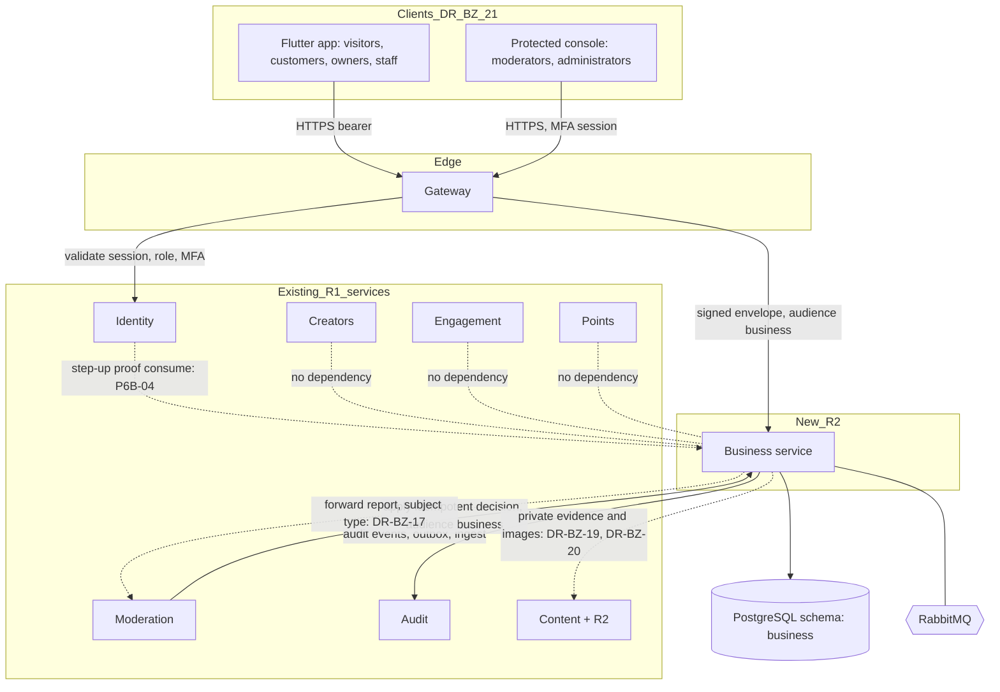
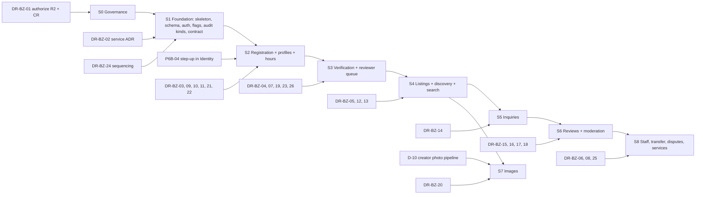

# Business module dependency diagrams

**Status: PROPOSED — Draft for owner review.** Phase 6A, 24 November 2026. Two views: runtime dependencies (who calls whom) and delivery dependencies (what must be decided or built first).

## 1. Runtime dependencies

Arrows point from caller to callee. Solid = required for the slice that introduces it; dashed = conditional on an owner decision. “Reads tables” never appears: no service reads another service's tables.

**Facts from the dependency view**

- Business has **no dependency on Creators, Engagement or Points** and none of them depends on Business. A creator reviewing a business is a customer account like any other.
- Business needs Identity only *through the Gateway* (session validation) plus the step-up capability (P6B-04). It never calls Identity to authenticate.
- Business → Audit is asynchronous (outbox). Business → Moderation is conditional (DR-BZ-17). Moderation → Business is a narrow, idempotent decision-application path, added to the callee's `CALLER_PATHS` allowlist for that single path.
- The data plane has one new schema and no cross-schema grants.

### Change surface in existing services (design only)

| Existing service | Change | Risk to R1 |
| --- | --- | --- |
| Gateway | New route module, flags (closed), contract entries, validators, tests | Low; flags closed; route-contract test guards |
| Audit | New producer, kinds, subject types; read-grant producer list (migration) | Low; additive; Audit tests must pass |
| Identity | Purpose-bound step-up consumption (P6B-04) | Medium; security-critical; separately approved |
| Moderation | Subject-type generalization; decision port (DR-BZ-17 A or C) | Medium; service is in R1 acceptance |
| Infra (SQL, Swarm, secrets, CI) | New schema/role, secrets, structure and drift tests | Medium; no AWS change in Phase 6A or 6B without approval |

## 2. Delivery dependencies

**Critical path to a first public listing:** DR-BZ-01 → S1 → (DR-BZ-03/09/10/11 + P6B-04) → S2 → (DR-BZ-04/07/19/23) → S3 → (DR-BZ-05/12/13) → S4. Customer inquiries (S5) and reviews (S6) are *not* needed for a first read-only directory, so discovery can ship before the highest-fraud feature.

### Parallelizable work

| Can proceed in parallel | Condition |
| --- | --- |
| Moderation generalization design (DR-BZ-17) and S2 | Design only until approved |
| Client design (Figma) for owner and customer screens and S1–S2 | DR-BZ-21 decided (24 November 2026); designs and route space need DR-BZ-27 |
| Privacy orchestration design (export/erase) and S1–S4 | Needed before S5/S6 store customer-authored text |
| Legal review (DR-BZ-23) and S1–S2 | Must finish before S3 and S6 |

## 3. Document dependency map

| Document | Depends on | Feeds |
| --- | --- | --- |
| [Requirements](../../requirements/DOC-020_Business_Requirements_and_Scope_PROPOSED.md) | PRD v0.2, DEC-001 | everything |
| [ADR-BIZ-001](../../adr/ADR-BIZ-001_Business_Bounded_Context_PROPOSED.md) | Requirements, ADR-001, ADR-013 | architecture, ERD, matrix |
| [Architecture](BIZ-ARCH_Service_Architecture_PROPOSED.md) | ADR | ERD, OpenAPI, backlog |
| [ERD](BIZ-ERD_PROPOSED.md) | Architecture | privacy, migrations (6B) |
| [OpenAPI proposal](BIZ-OpenAPI_3_1_PROPOSAL.yaml) | Architecture, matrix | DOC-205 merge, gateway tests |
| [Authorization matrix](../../security/phase6/BIZ-RBAC_and_Object_Authorization_Matrix_PROPOSED.md) | Requirements, ADR | tests, OpenAPI security |
| [STRIDE](../../security/phase6/BIZ-STRIDE_Threat_Model_PROPOSED.md) | Architecture, matrix | acceptance, DOC-203/206 merge |
| [Privacy and retention](../../privacy/business-data-privacy-and-retention-PROPOSED.md) | ERD, ADR-020 | decision register |
| [Backlog](../../engineering/phase6/BIZ-Implementation_Backlog_PROPOSED.md) | all | Phase 6B |
| [Acceptance criteria](../../engineering/phase6/BIZ-Acceptance_Criteria_PROPOSED.md) | Requirements, matrix, STRIDE | Phase 6B tests |
