# Business service database ERD

**Status: PROPOSED — illustrative design, not DDL. No migration is created or implied by Phase 6A.** Phase 6A, 24 November 2026. Conventions follow [DOC-204](../DOC-204_ERD.mmd): UUID primary keys, cross-service references are plain UUID columns with **no foreign keys**, and the service owns its schema (`business`).

## 1. Entity-relationship diagram

```mermaid
erDiagram
  BUSINESS ||--o{ BUSINESS_MEMBERSHIP : has
  BUSINESS ||--o{ PROFILE_REVISION : versions
  BUSINESS ||--o| BUSINESS_LISTING : projects
  BUSINESS ||--o{ HOURS_RULE : opens
  BUSINESS ||--o{ HOURS_EXCEPTION : exceptions
  BUSINESS ||--o{ VERIFICATION_CASE : verified_by
  BUSINESS ||--o{ INQUIRY_THREAD : receives
  BUSINESS ||--o{ REVIEW : receives
  BUSINESS ||--o{ INQUIRY_BLOCK : blocks
  BUSINESS ||--o{ OWNERSHIP_DISPUTE : disputed
  BUSINESS ||--o{ BUSINESS_SERVICE : offers
  BUSINESS_CATEGORY ||--o{ PROFILE_REVISION : classifies
  BUSINESS_CATEGORY ||--o{ BUSINESS_CATEGORY : parent_of
  PROFILE_REVISION ||--o{ CONTACT_CHANNEL : lists
  VERIFICATION_CASE ||--o{ VERIFICATION_EVIDENCE : holds
  VERIFICATION_CASE ||--o{ VERIFICATION_DECISION : decided_by
  INQUIRY_THREAD ||--o{ INQUIRY_MESSAGE : contains
  REVIEW ||--o| REVIEW_RESPONSE : answered_by
  REVIEW ||--o{ REVIEW_REVISION : history
  REVIEW ||--o| REVIEW_HOLD : may_have
  BUSINESS ||--o{ BUSINESS_AUDIT_EVENT : records
  BUSINESS_AUDIT_EVENT ||--o| BUSINESS_AUDIT_DELIVERY : delivered
```

External (other service) identifiers appear only as UUID columns: `account_id` (Identity), `video_id` and `creator_id` (not used here), moderation action ids (Moderation). There is no relationship line to them.

## 2. Tables and key columns

Column lists are the *proposed* minimum. “Public” means the column may appear in `business_listing` or a public API; everything else is private to the service, its owner or authorized reviewers. Types are illustrative.

### 2.1 Core and authorization

| Table | Key columns | Constraints and notes |
| --- | --- | --- |
| `business` | `id` PK; `state` (draft, submitted, under_review, needs_info, verified, rejected, suspended, revoked, closed); `created_by_account_id` UUID; `verified_at`; `suspended_at`; `closed_at`; `current_revision_id` (approved); `working_revision_id`; `version` int (optimistic lock); `created_at` | Check: `verified` requires `verified_at`. State transitions only through one function. Soft close, never row delete. |
| `business_membership` | `id` PK; `business_id` FK; `account_id` UUID; `role` (owner, staff); `status` (invited, active, revoked); `granted_by_account_id`; `created_at`; `revoked_at` | Unique `(business_id, account_id)`. Invariant (transaction): at least one active owner while the business is not closed. `role` is never accepted from a client body. |
| `business_category` | `id` PK; `slug` unique; `parent_id` nullable; `name`; `active`; `sort_order` | Max two levels (check). Administrator-managed. |
| `reviewer_grant` | `id` PK; `reviewer_account_id` UUID; `scope` (verification, review_queue, disputes); `target_business_id` nullable; `active`; `granted_by_account_id`; `created_at` | Explicit, scoped grants following `ModeratorAssignment`. Unique active `(reviewer, scope, target)`. Evidence read needs scope `verification` (narrower than queue view). |

### 2.2 Profile, contacts, hours

| Table | Key columns | Constraints and notes |
| --- | --- | --- |
| `profile_revision` | `id` PK; `business_id` FK; `revision_no`; `state` (draft, pending_review, approved, rejected, superseded); `display_name`; `legal_name` **(private)**; `category_id` FK; `description`; `county_code`; `city`; `address_line` **(owner-opt-in public)**; `latitude`, `longitude` **(owner-opt-in; coarsened if public)**; `time_zone`; `submitted_at`; `reviewed_by_account_id`; `reviewed_at`; `reason_code` | Unique `(business_id, revision_no)`. At most one `approved` current and one working revision (partial unique indexes). Text bounds enforced at DB (`varchar`) and in validators. |
| `contact_channel` | `id` PK; `revision_id` FK; `kind` (phone, email, website, social); `value`; `is_public` bool; `confirmed_at` nullable | `value` validated per kind; website `https` only. Confirmation by one-time proof if DR-BZ-04 includes it. Private values never copied to the projection. |
| `hours_rule` | `id` PK; `business_id` FK; `weekday` 0–6; `opens_local` time; `closes_local` time | Non-overlapping per `(business_id, weekday)` (exclusion constraint or validated). Overnight intervals are stored as two rows. Owner-editable without moderation (low risk). |
| `hours_exception` | `id` PK; `business_id` FK; `on_date` date; `closed` bool; `opens_local`; `closes_local` | Unique `(business_id, on_date)`. |
| `business_service` | `id` PK; `business_id` FK; `name`; `description`; `state`; `sort_order` | **Later slice.** No price or payment fields. |

### 2.3 Listing projection (public read model)

| Table | Key columns | Notes |
| --- | --- | --- |
| `business_listing` | `business_id` PK/FK; `listed` bool; `verified` bool; `display_name`; `category_slug`; `county_code`; `city`; `summary`; `public_contact` JSON (only `is_public` channels, per DR-BZ-12); `open_state_hours_hash`; `rating_count`; `rating_sum`; `search_vector` tsvector; `updated_at` | **Only public columns.** Written in the same transaction as any change to the eligibility inputs. GIN index on `search_vector`; trigram index on `display_name`; btree on `(county_code, category_slug)`. Rating average is derived (`rating_sum / rating_count`) and shown only above the policy minimum. |

### 2.4 Verification and disputes

| Table | Key columns | Constraints and notes |
| --- | --- | --- |
| `verification_case` | `id` PK; `business_id` FK; `state` (submitted, under_review, needs_info, verified, rejected, withdrawn, revoked); `submitted_by_account_id`; `assigned_reviewer_account_id`; `method` (policy-defined enum); `submitted_at`; `decided_at`; `expires_at` nullable; `version` | One open case per business (partial unique index). `assigned_reviewer` ≠ `submitted_by` (check). |
| `verification_evidence` | `id` PK; `case_id` FK; `kind` (policy-defined); `storage_key`; `sha256`; `size_bytes`; `content_type`; `state` (pending, accepted, quarantined, purged); `uploaded_by_account_id`; `purge_after` nullable | **Private.** Stored only as private R2 object references; never a public URL. Present only from the slice that enables evidence. Retention per DR-BZ-18/19. |
| `verification_decision` | `id` PK; `case_id` FK; `decided_by_account_id`; `decision`; `reason_code`; `idempotency_key`; `payload_digest`; `created_at` | Unique `(decided_by, idempotency_key)`; a repeated key returns the same result, a different key on a decided case conflicts. Mirrors Moderation receipts. |
| `ownership_dispute` | `id` PK; `business_id` FK; `filed_by_account_id`; `state`; `reason_code`; `decided_by_account_id`; `created_at`; `decided_at` | **Later slice.** Freezing the listing is a state on `business`, not here. |

### 2.5 Inquiries

| Table | Key columns | Constraints and notes |
| --- | --- | --- |
| `inquiry_thread` | `id` PK; `business_id` FK; `customer_account_id` UUID **(private; never returned to the business)**; `customer_label` (display-name snapshot); `subject_code` (enum); `state` (open, closed_by_customer, closed_by_business, blocked, removed); `created_at`; `last_message_at` | Unique open thread per `(business_id, customer_account_id)` (partial) if the policy limits parallel threads. |
| `inquiry_message` | `id` PK; `thread_id` FK; `author_kind` (customer, business); `author_account_id` UUID; `body` text bounded; `state` (visible, removed); `created_at` | No attachment columns (DR-BZ-14). |
| `inquiry_block` | `id` PK; `business_id` FK; `customer_account_id` UUID; `blocked_by_account_id`; `created_at` | Unique `(business_id, customer_account_id)`. |

### 2.6 Reviews

| Table | Key columns | Constraints and notes |
| --- | --- | --- |
| `review` | `id` PK; `business_id` FK; `author_account_id` UUID **(private)**; `rating` smallint 1–5; `title` nullable; `body` text bounded; `state` (pending, published, held, removed, withdrawn); `eligibility_basis` (policy enum, e.g. open, interaction_confirmed, invited, evidence); `created_at`; `edited_at`; `published_at`; `moderation_revision` int | Check `rating` between 1 and 5. Unique active `(business_id, author_account_id)` where `state` not `withdrawn`. Author id never leaves the service except as the policy-approved display label. |
| `review_response` | `id` PK; `review_id` FK unique; `author_account_id`; `body`; `state`; `created_at` | One per review. |
| `review_revision` | `id` PK; `review_id` FK; `body`; `rating`; `created_at` | History; **retention pending DR-BZ-16/18**; may be dropped if policy forbids history. |
| `review_hold` | `review_id` PK/FK; `reason_codes` (array of codes only); `opened_at`; `released_by_account_id`; `released_at` | Reason codes from a fixed vocabulary; no raw signal values (IP, device) are stored. |
| `moderation_receipt` | `action_id` PK (Moderation's action id); `subject_type`; `subject_id`; `previous_revision`; `applied_at` | Makes decision application idempotent (pattern from Content's `ModerationReceipt`). |

### 2.7 Platform tables (same as every service)

| Table | Purpose |
| --- | --- |
| `internal_request_nonce`, `event_outbox`, `event_inbox` | Created by `schema_isolation.sql` for each service; the nonce table backs the service-identity verifier. |
| `business_audit_event`, `business_audit_delivery` | Local outbox for Audit ingest, as in Moderation. Payload: id, actor id, kind, subject type/id, time. |
| `throttle_counter` | Hashed key, count and window start, for budgets (pattern from Identity's `LoginThrottle`). Keys are digests of account/IP-derived values, never raw values. |

## 3. Integrity rules the schema must enforce

1. `business_membership`: at least one active owner while a business is open (transactional check, tested with concurrent removals).
2. `verification_case`: at most one open case per business; reviewer differs from submitter.
3. `review`: one active review per `(business, author)`; rating 1–5; author is not a member of the business (checked in the service because membership is in another table of the same schema and changes over time — also asserted in tests).
4. `profile_revision`: one current approved revision per business.
5. `business_listing` contains no column that is not intended to be public; a test lists its columns and fails on additions without review.
6. No foreign key crosses the service boundary; UUID references are validated by the service on write where the owning service exposes a check, never by joining.

## 4. Data classification (summary)

Detailed treatment is in the [privacy document](../../privacy/business-data-privacy-and-retention-PROPOSED.md).

| Class | Columns |
| --- | --- |
| Public | `business_listing.*`, approved public contact channels, public review text and rating, published owner responses |
| Owner-private | `legal_name`, non-public contacts, working revisions, hours edits in progress |
| Reviewer-private | verification evidence and decisions, holds, ownership disputes |
| Customer-private | `customer_account_id`, `author_account_id`, inquiry messages (visible to the thread participants), reviewer-visible review authorship |
| Operational | nonces, outbox, throttles, audit outbox |

## 5. Not modelled (deliberately)

Payments, prices, bookings, tickets, advertising, sponsorship or promotion, push tokens, device identifiers, IP addresses, precise customer location, full identity documents (unless DR-BZ-19 allows), social graph, analytics counters.
