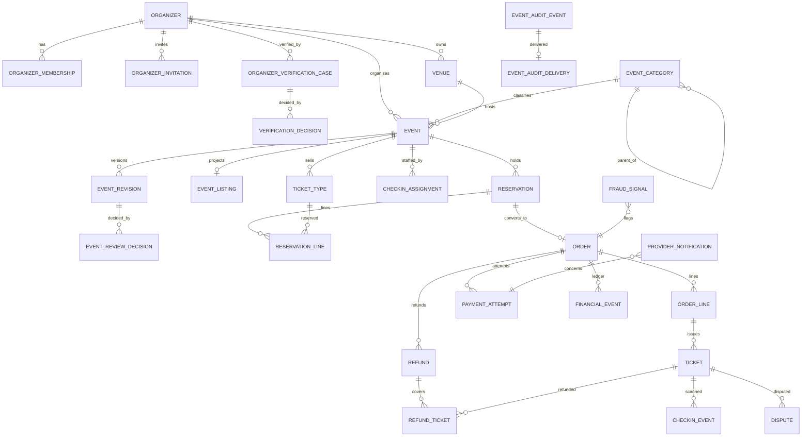

# Events service database ERD (proposed)

> Phase 2: current ownership and approved decision precedence are in [the ownership review](../PHASE-02_Data_Ownership_Review.md). Finance alone owns monetary ledger/provider adapters; Decision J uses Points snapshots as relative allocation weights, never redemption. Conflicting historical text below is superseded. Detailed accounting/policy review remains pending.

**Status: PROPOSED — illustrative design, not DDL. No migration is created or implied by Phase 7A.** 25 November 2026. Conventions follow [DOC-204](../DOC-204_ERD.mmd) and the [Business ERD](../business/BIZ-ERD_PROPOSED.md): UUID primary keys, cross-service references are plain UUID columns with **no foreign keys**, the service owns its schema (`events`). Money is `bigint` minor units with a three-letter currency code; times are UTC.

## 1. Diagram

External identifiers appear only as UUID columns: `account_id` (Identity), reviewer ids (Identity accounts). No relationship line to them. The service stores **no** buyer name, email or phone.

## 2. Tables and key columns

“Public” means the column may appear in `event_listing` or a public API. Everything else is private to the service, the organizer's authorized members or an authorized reviewer.

### Organizer side (E1)

| Table | Key columns | Notes |
| --- | --- | --- |
| `organizer` | id, display_name (public), county, status, created_by_account_id, version | `status` server-only; unique `(created_by_account_id)` while open, limit by configuration |
| `organizer_registration_grant` | id, account_id, granted_by, expires_at, used_at | Invitation-only registration (DR-EV-10) |
| `organizer_membership` | id, organizer_id, account_id, role (`owner`/`manager`/`checkin`), status, granted_by | Unique `(organizer_id, account_id)` while active; the single authorization predicate reads this |
| `organizer_invitation` | id, organizer_id, role, code_hash, expires_at, redeemed_by, redeemed_at | Code stored hashed, single use |
| `organizer_verification_case` | id, organizer_id, state, round, submitted_at, valid_until | Structured declaration; no file columns until DR-EV-17 |
| `verification_decision` | id, case_id, reviewer_id, decision, reason_code, at | Append-only |
| `organizer_reviewer_grant` | id, account_id, scope (`organizer_review`/`event_review`/`dispute_review`/`fraud_review`/`refund_review`), granted_by, revoked_at | Moderators and administrators only |

### Event side (E2, E3)

| Table | Key columns | Notes |
| --- | --- | --- |
| `venue` | id, organizer_id, name, address_line, county, city, status; private lat/lon | Organizer-owned |
| `event_category` | id, parent_id, slug, name, active | Two levels at most |
| `event` | id, organizer_id, category_id, state, visibility, current_revision_id, published_revision_id, cancelled_reason_code, version | Server-only `state`; `version` for optimistic concurrency |
| `event_revision` | id, event_id, revision_no, state, title, description, venue_id, starts_at, ends_at, timezone, capacity_total, refund_policy, refund_until, submitted_at | Material fields live here so the live revision cannot be edited in place |
| `event_review_decision` | id, revision_id, reviewer_id, decision, reason_code, at | Append-only; reviewer ≠ organizer member |
| `event_listing` | event_id, revision_id, title, category_id, county, city, starts_at, ends_at, price_from_minor, currency, availability_band, status | **Projection**: public columns only; written when the eligibility predicate changes |
| `checkin_assignment` | id, event_id, account_id, assigned_by, revoked_at | Scopes the `checkin` role to events |

### Inventory and orders (E4, E5)

| Table | Key columns | Notes |
| --- | --- | --- |
| `ticket_type` | id, event_id, name, price_minor, currency, quantity_total, reserved_count, sold_count, sales_start, sales_end, per_order_max, state, version | `CHECK (reserved_count >= 0 AND sold_count >= 0 AND reserved_count + sold_count <= quantity_total)` |
| `reservation` | id, event_id, account_id, status, expires_at, idempotency_key | Unique `(account_id, idempotency_key)` |
| `reservation_line` | reservation_id, ticket_type_id, quantity | |
| `order` | id, account_id, event_id, reservation_id (unique), status, currency, subtotal_minor, fee_minor, tax_minor, total_minor, pricing_snapshot (json, immutable), fee_policy_version, provider, provider_intent_ref, expires_at, idempotency_key | No mutable money balance columns |
| `order_line` | id, order_id, ticket_type_id, unit_price_minor, quantity | Price copied at order time |
| `payment_attempt` | id, order_id, provider, provider_ref, status, amount_minor | |
| `provider_notification` | id, provider, provider_event_id, payload_hash, signature_ok, received_at, processed_at, outcome | **Unique `(provider, provider_event_id)`**: the replay guard; raw payload not stored, only its hash |
| `idempotency_record` | account_id, operation, key, request_hash, response, expires_at | Same pattern as Business |

### Ledger (E5) — the single money ledger

| Table | Key columns | Notes |
| --- | --- | --- |
| `financial_event` | id, seq (monotonic), order_id, kind, direction (`in`/`out`), amount_minor, currency, provider_ref, idempotency_key (**unique**), prev_hash, hash, created_at | **Append-only**: trigger rejects UPDATE and DELETE; runtime role has INSERT and SELECT only; hash chain per ledger. Kinds: `payment_captured`, `fee_assessed`, `refund_requested`, `refund_settled`, `refund_failed`, `adjustment` (administrator, two-person) |
| `refund` | id, order_id, state, reason_code, amount_minor, requested_kind (`buyer`/`event_cancelled`/`system`/`administrator`), requested_by, approved_by, idempotency_key | Unique open refund per ticket (via `refund_ticket`) |
| `refund_ticket` | refund_id, ticket_id | Unique `(ticket_id)` among non-failed refunds |

### Tickets and check-in (E6)

| Table | Key columns | Notes |
| --- | --- | --- |
| `ticket` | id, public_id (random 128-bit, unique), order_id, order_line_id, event_id, ticket_type_id, owner_account_id, status, credential_version, issued_at, admitted_at, admitted_by, gate | Unique `(order_line_id, seq)`; admission is one conditional UPDATE on `status = 'valid'` |
| `checkin_event` | id, ticket_id (nullable if invalid), event_id, scanner_account_id, device_label, result, at | **Append-only**; includes refusals |
| `qr_signing_key` | version, secret_ref, active_from, retired_at | Key material is a configured secret reference, not a column of key bytes |

### Administration (E7)

| Table | Key columns | Notes |
| --- | --- | --- |
| `dispute` | id, ticket_id, order_id, opened_by, reason_code, state, adjudicated_by, outcome, due_at | Bounded outcome set (DR-EV-28) |
| `fraud_signal` | id, subject_kind, subject_id, rule, score, state, reviewed_by | Signals are evidence, never automatic penalties |
| `event_audit_event` | id, kind, actor_id, subject_ids, at | Id-only, written in the deciding transaction |
| `event_audit_delivery` | audit_event_id, state, attempts, delivered_at | Outbox to the Audit service, as Business |

## 3. Integrity constraints that carry the security claims

| Claim | Constraint |
| --- | --- |
| Never oversell | `CHECK` on `ticket_type` plus the row-locked reservation transaction |
| One order per reservation | unique `order.reservation_id` |
| Retry returns the same result | unique `(account_id, idempotency_key)` on reservation and order |
| Webhook replay is a no-op | unique `(provider, provider_event_id)` |
| Ledger cannot post twice | unique `financial_event.idempotency_key` |
| Ledger cannot be edited | trigger rejecting UPDATE/DELETE; hash chain; INSERT-only role |
| Refund cannot exceed capture | computed from `financial_event` under `SELECT ... FOR UPDATE` on the order row |
| One refund per ticket | unique `refund_ticket(ticket_id)` among non-failed refunds |
| Admit once | conditional UPDATE on `ticket.status`; `checkin_event` records the loser |
| Public reads leak nothing private | `event_listing` has only public columns |

## 4. Cross-service interactions

| Direction | Mechanism | Purpose |
| --- | --- | --- |
| Gateway → Events | HTTP, signed envelope | All client calls |
| Events → Identity | none at request time | Identity facts arrive in the envelope; there is no account lookup of names or contacts |
| Events → Audit | outbox delivery | Audit events |
| Provider → Events | notification handled in-process (sandbox) | Payment and refund results |
| Console → Gateway → Events | HTTP | Reviewer and administrator actions |
