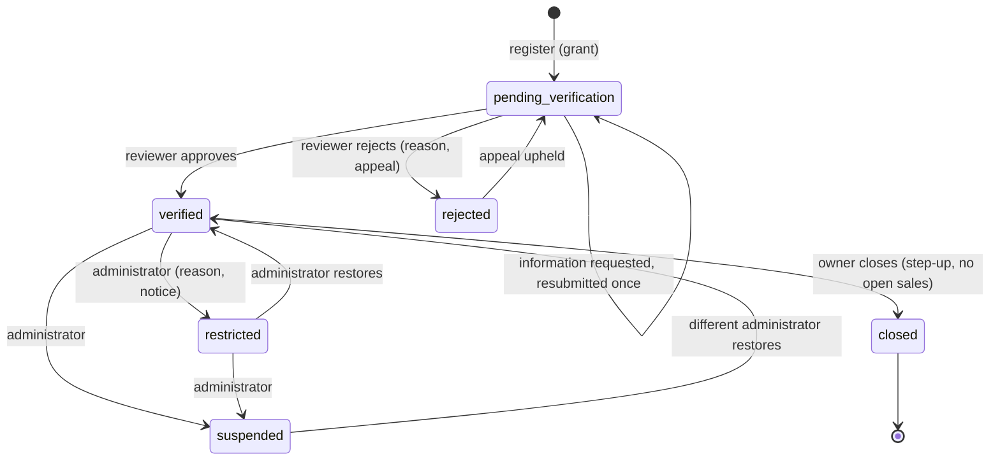
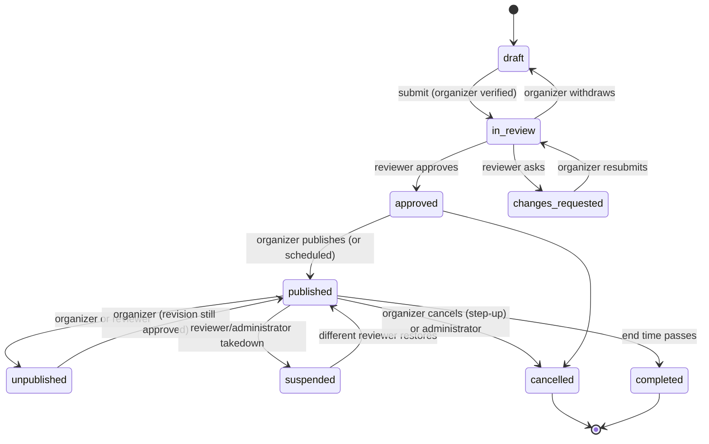
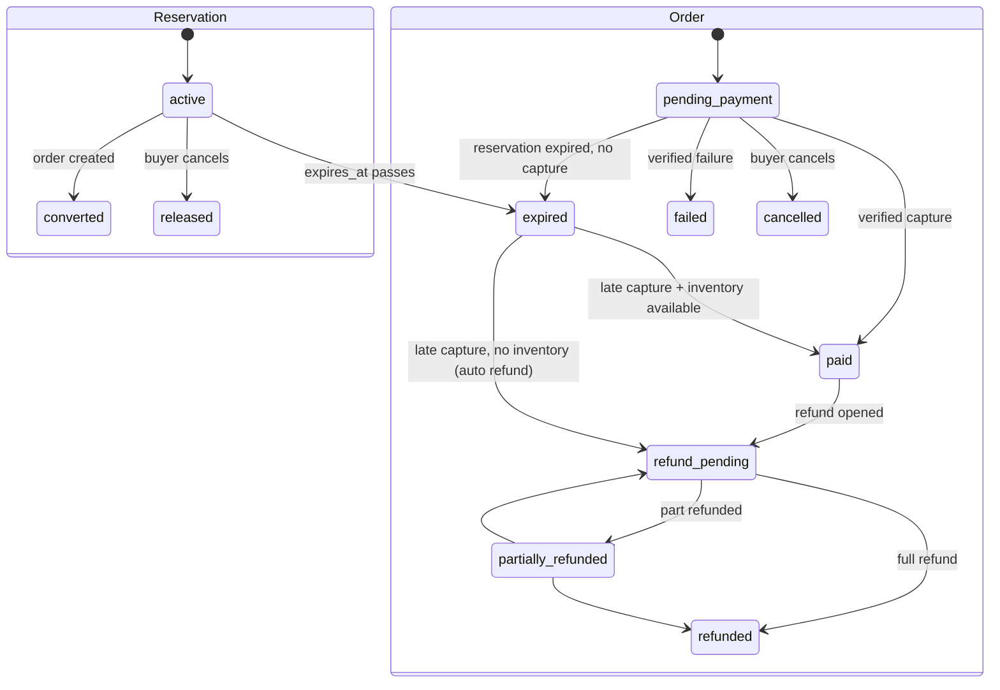
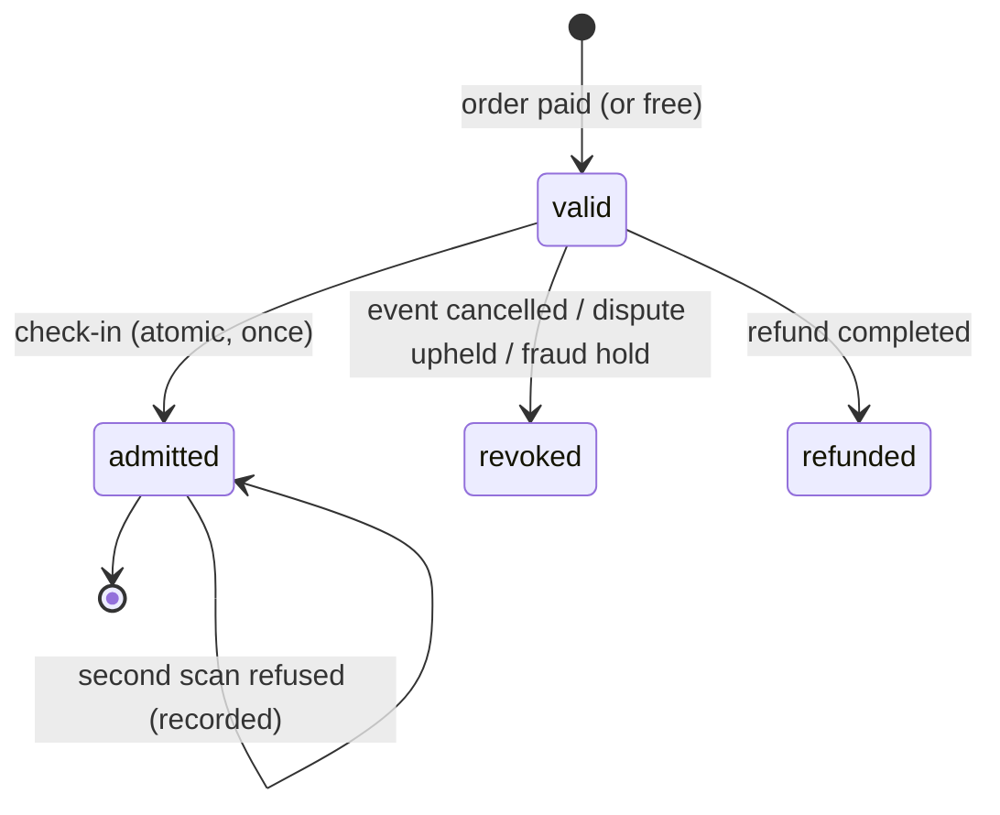
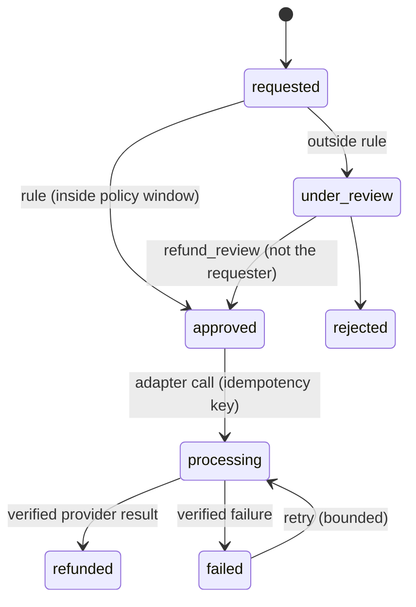
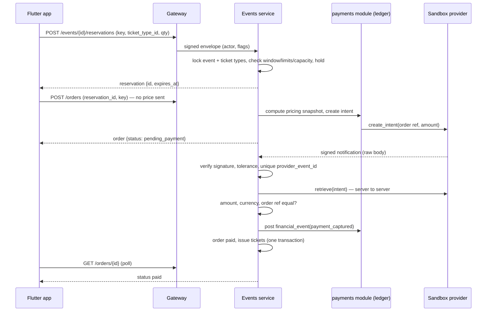

# Events — journeys and server-controlled state machines (proposed)

**Status: PROPOSED — not approved.** Phase 7A, 25 November 2026. States are **server-controlled**: a client never sends a state, only a *request* (`submit`, `cancel`, …) that the server accepts or refuses.

## 1. Organizer journey (Flutter)

1. Receives an administrator grant or invitation → registers an organizer (owner assigned by the server) → state `pending_verification`.
2. Completes organizer profile → submits verification (contact proof and declaration) → reviewer decides in the console → `verified` (or an information request, one resubmission, or rejection with reason code and appeal).
3. Invites a manager and check-in staff (code, single use, 72 h) → staff redeem in their own app.
4. Creates a venue and a draft event → adds ticket types → submits for review → reviewer approves → organizer publishes (or `approved` publishes on schedule).
5. Watches the dashboard: sales, reservations, counts, refund requests.
6. Event day: a check-in staff member opens the event in the app, scans tickets; results appear instantly.
7. Optional: cancels the event (step-up + reason) → tickets revoked, refunds created, buyers see `cancelled`.

## 2. Attendee journey (Flutter)

1. Opens Discover (anonymous allowed) → searches, filters by category, county, date.
2. Opens an event → sees ticket types and availability → chooses quantities (verified email and sign-in required from here).
3. Server creates a **reservation** (10-minute hold) → app shows a countdown that is a *display* of the server `expires_at`.
4. Starts checkout → server computes the total → sandbox payment completes server-side → app polls order status → `paid` → tickets appear in **My tickets**.
5. Event day: opens a ticket, shows the QR; staff scan; ticket shows `admitted`.
6. Before the refund deadline: requests a refund → rule-based decision or review → `refunded`.
7. If something is wrong: opens a dispute from the ticket.

## 3. Reviewer and administrator journey (console, MFA)

Organizer verification queue → claim → request information or decide. Event review queue → approve, request changes or reject; later takedown with reason. Refund review → approve or reject (requester ≠ approver). Disputes → decide within the bounded outcomes. Fraud signals → review, hold or dismiss. Cancellation oversight → list of cancelled events with refund completion, stuck refunds, failures. Audit history → read-only.

## 4. State machines

### 4.1 Organizer

### 4.2 Event

A published event's *material edit* creates a new `event_revision` in `in_review`; the previous approved revision stays public until the new one is approved. The state above is on the event; revision state is `draft`, `submitted`, `approved`, `rejected`, `superseded`.

### 4.3 Reservation and order

`failed`, `expired` and `cancelled` release the reservation's inventory exactly once (guarded by the reservation's own status, so a replay cannot release twice).

### 4.4 Ticket

`admitted`, `revoked` and `refunded` are terminal for admission. An `admitted` ticket is refundable only by a dispute outcome, never by the buyer rule.

### 4.5 Refund

## 5. Money-event sequence (checkout)

The redirect or return of the app from any payment screen only triggers the `GET` poll above.
