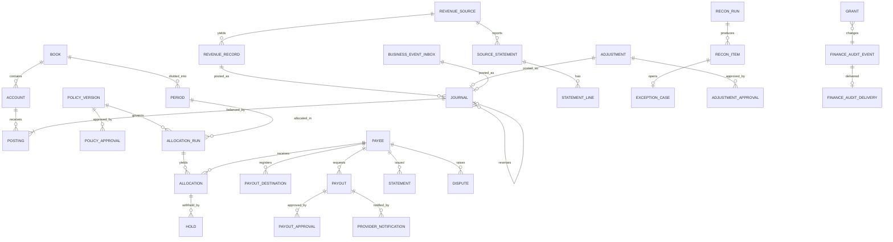
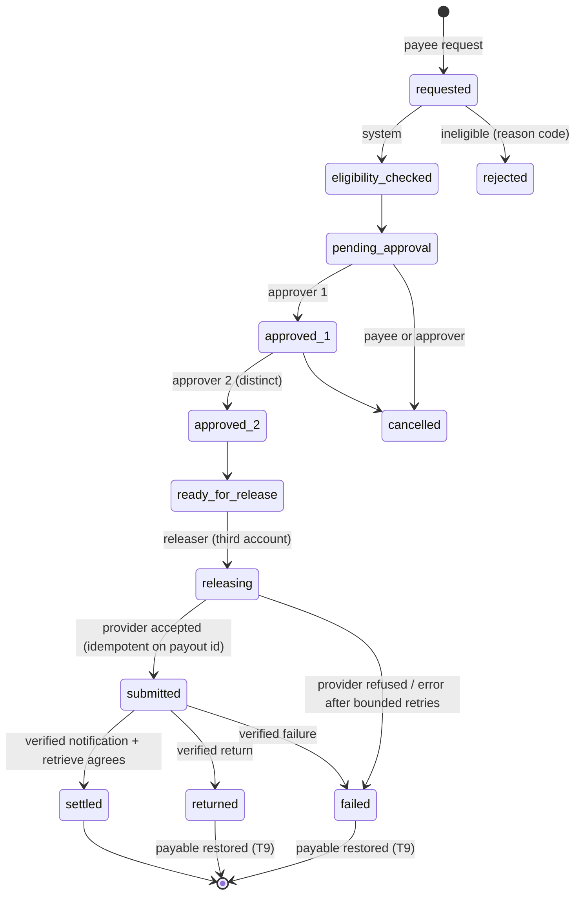
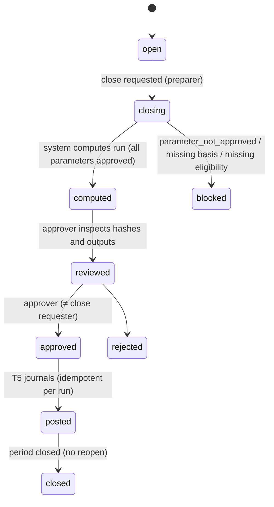

# Finance service database ERD and state machines (proposed)

**Status: PROPOSED — illustrative design, not DDL. No migration is created or implied by Phase 9A.** 25 November 2026. Conventions follow [DOC-204](../DOC-204_ERD.mmd): UUID keys, cross-service references are plain UUID columns with **no foreign keys**, own schema (`finance`). Amounts: `bigint` minor units; calculation intermediates `NUMERIC(38,18)`; **no float or real column exists**.

## 1. Diagram

External ids appear only as UUID columns: `account_id` (Identity, for payees and staff), producer object ids carried inside signed events. Finance stores **no** names, emails, phones or document images.

## 2. Tables and key columns

### Ledger core (F1)

| Table | Key columns | Notes |
| --- | --- | --- |
| `book` | id, environment (`sandbox`/`live`), base_currency, status | `live` row creation requires the approval constant; no data crosses books |
| `currency` | code, minor_exponent, approved_by_policy | Only approved codes |
| `account` | id, book_id, code, name, type, currency, subledger_kind, subledger_key | Unique `(book_id, code, subledger_key, currency)`; chart changes are audited |
| `journal` | id, book_id, seq (monotonic), kind, template, period_id, reverses_journal_id (unique, nullable), idempotency_key (**unique**), source_ref, policy_hashes, created_at, prev_hash, hash | **Append-only**; reversal unique per original |
| `posting` | id, journal_id, account_id, side (`debit`/`credit`), amount_minor (> 0), currency | `CHECK` positive; currency equals account's; **deferred constraint trigger**: per journal and currency debits = credits |
| `period` | id, book_id, label, starts_at, ends_at, state (`open`/`closing`/`closed`), closed_by_approval | No transition out of `closed`; journals for a closed period are refused |
| `balance_projection` | account_id, as_of_seq, balance_minor | **Non-authoritative**; verifier compares with sum of postings |

### Policy (F3)

| Table | Key columns | Notes |
| --- | --- | --- |
| `policy_version` | id, kind, version_no, parameters (json), content_hash, environment, status, author_id, effective_from | Immutable after submission; unique `(kind, version_no)` |
| `policy_approval` | id, policy_id, approver_id, evidence_ref, content_hash, at | Approver ≠ author; independent evidence reference required for live |

### Revenue (F2)

| Table | Key columns | Notes |
| --- | --- | --- |
| `revenue_source` | id, class, name, provider_kind, shareable_policy_ref, status | Class from the approved list |
| `revenue_record` | id, source_id, provider_reference, class, amount_minor, currency, state, recorded_via (`statement`/`event`/`manual`), period_id, origin_event_id | **Unique `(source_id, provider_reference)`**; amounts immutable; state moves forward by new rows in `revenue_record_state` |
| `revenue_record_state` | record_id, state, journal_id, at | Append-only history |
| `source_statement` / `statement_line` | source, period, hash / provider_reference, amount, currency, raw_hash | Raw payload stored as hash plus minimal fields |
| `recon_run` / `recon_item` | scope, period, state / kind (`matched`, `missing_in_ledger`, `missing_in_source`, `amount_mismatch`, `duplicate_reference`, …), refs | Never edits ledger |
| `exception_case` | id, recon_item_id, state, prepared_by, resolution_kind, adjustment_id | Resolved only through an approved adjustment or waiver |
| `business_event_inbox` | source_service, source_event_id (**unique together**), kind, schema_version, payload_hash, accepted_at, journal_id, outcome | Allowlist check; rejected kinds counted |

### Sharing (F3)

| Table | Key columns | Notes |
| --- | --- | --- |
| `payee` | id, account_id (unique per book), kind (`creator`/`business`), status, eligibility_state | One payee per account; **cannot coexist with any grant** |
| `basis_dataset` | id, period_id, provider, version, content_hash, row_count | Period-final and immutable |
| `eligibility_snapshot` | id, period_id, provider, as_of, content_hash | Signed |
| `allocation_run` | id, period_id, sharing_policy_id, ledger_cutoff_seq, basis_id, eligibility_id, state, run_hash, computed_at, reviewed_by, approved_by | Immutable after `computed`; `run_hash` reproducible |
| `allocation` | id, run_id, payee_id, currency, amount_minor, released_minor, held_minor, reason_codes | Unique `(run_id, payee_id, currency)`; `released + held = amount` check; run totals checked against distributable |
| `hold` | id, allocation_id, reason, state, placed_by, released_by | Release creates an approval and journal |
| `statement` | id, payee_id, period_id, version, totals, content_hash, issued_at | Immutable; regenerable from ledger |
| `dispute` | id, payee_id, subject_kind, subject_id, reason_code, state, decided_by, outcome | Outcome becomes an adjustment |

### Payouts (F5)

| Table | Key columns | Notes |
| --- | --- | --- |
| `payout_destination` | id, payee_id, provider_token_ref, display_mask, verified_at, status | **No raw account number stored**; token held by the provider; mask only |
| `payout` | id, payee_id, amount_minor, currency, state, destination_id, requested_at, idempotency_key, provider_ref, journal_ids | Unique open payout per payee unless policy allows more; amount ≤ released payable (checked under payee row lock) |
| `payout_approval` | id, payout_id, role (`approver_1`/`approver_2`/`releaser`), actor_id, content_hash, at | **Unique `(payout_id, actor_id)`** and `(payout_id, role)`; payee excluded |
| `provider_notification` | provider, provider_event_id (**unique together**), payload_hash, signature_ok, received_at, outcome | Replay guard |

### Control and audit (F6)

| Table | Key columns | Notes |
| --- | --- | --- |
| `finance_grant` | id, account_id, grant, granted_by, approved_by, revoked_at | Exclusivity constraints; excluded for payees |
| `adjustment` / `adjustment_approval` | kind, reason_code, evidence_ref, amount, prepared_by / role, actor, content_hash | Two distinct approvers, preparer excluded; payee excluded |
| `freeze` | id, scope, placed_by, lifted_by, second_approver | Asymmetric |
| `finance_audit_event` | id, seq, kind, actor_id, grant_used, subject_ids, policy_hashes, at, prev_hash, hash | Append-only, chained; daily digest exported |
| `finance_audit_delivery` | event_id, state, attempts | Outbox to Audit (ids only) |
| `idempotency_record`, `nonce` | as Business | |

## 3. Integrity constraints that carry the correctness claims

| Claim | Constraint |
| --- | --- |
| Every journal balances | Deferred constraint trigger per journal and currency |
| Ledger cannot be edited | UPDATE/DELETE-rejecting triggers; INSERT-only role; hash chain |
| Same event posts once | Unique inbox key and unique journal idempotency key, committed together |
| Revenue counted once | Unique `(source_id, provider_reference)` |
| Reversal at most once | Unique `reverses_journal_id` |
| No currency mixing | Posting currency equals account currency; one currency per balance group |
| Closed periods frozen | Posting refused when its period is closed |
| Allocations conserve | Run total check and `released + held = amount`; recomputation by verifier |
| Payee cannot exceed payable | Row lock on payee, payout amount ≤ released payable minus open payouts |
| Duplicate settlement impossible | Unique posting per `(payout_id, template)`; unique provider notifications |
| Approvals distinct | Unique constraints on `(object, actor)`; payee and preparer exclusion checks |
| Approvals bind to content | `content_hash` compared to object at post time |
| No Points dependency | No column, table or import referencing Points |

## 4. State machines

### Payout

A retry is a *new* payout and a new approval cycle. A frozen book blocks `releasing`.

### Allocation run and period

### Policy version, revenue record, hold

Policy: `draft → submitted → approved → superseded`. Revenue record: `recorded → recognized → collected → reconciled`, with `disputed` and `written_off` branches (approved). Hold: `placed → released` (approved) or `converted_to_adjustment`.

## 5. Cross-service interactions

| Direction | Mechanism | Purpose |
| --- | --- | --- |
| Producers → Finance | outbox → Celery/RabbitMQ → inbox (`accept_once`), signed, allowlisted | Revenue and payment facts |
| Finance → `BasisProvider`, `EligibilityProvider` owners | signed read at period close | Basis and eligibility snapshots, hashed |
| Finance → Audit | outbox | Id-only audit |
| Gateway → Finance | signed envelope (actor, role, MFA, grant evaluated in Finance) | Client and console |
| Finance ↔ Points | **none** | Separation |
| Finance → payout provider | adapter interface (sandbox) | Payouts |
