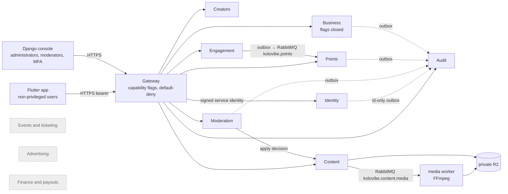

# Phase 10 — Platform development integration: report

**Date:** 25 November 2026. **Base:** `main` at `e9bb068` plus the Phase 7A, 8A and 9A design packages and the two fixes below, on branch `claude/blissful-albattani-81b81r`. **Scope:** inspection, verification, and focused fixes of confirmed defects. **No** deployment, **no** AWS or staging action, **no** migration added, **no** merge. **Production readiness is not claimed.** Every Business capability flag is still closed and the staging capability set still carries no Business capability.

## 0. Read this first

1. **Only nine of the fifteen modules you listed exist as code.** Identity, Creators, Content, Engagement, Points, Moderation, Audit, Gateway, Business, the Flutter app and the console are implemented. **Events, Ticketing, Advertising and Revenue/financial workflows exist only as Phase 7A, 8A and 9A design packages. They were never approved, no code exists, and nothing was built in this phase.** They are therefore not "integrated"; they are listed in the matrix as *Not implemented — blocked by product approval* (and, for payments and networks, provider and legal approval). Building them to make this phase look complete would have broken the approval gates those packages ask for.
2. **What this phase proves.** The nine implemented modules were exercised together on disposable infrastructure: every service suite, the console, the script suites, a real TLS PostgreSQL for every migration, eleven real-HTTP gateway journeys, the staging runtime, and — new — the Engagement-to-Points event path on a **real RabbitMQ** with least-privilege accounts, plus Flutter analysis and **1,823** widget and unit tests on the CI-pinned SDK 3.47.8.
3. **What it does not prove.** Nothing ran on a phone, on AWS, against real Cloudflare R2, or against the deployed broker. Those are Phase 11 and owner staging checks (section 11).
4. **Two defects were found and fixed** (section 4); **three gaps were confirmed and left open** with owners (section 10).

## 1. Full application implementation matrix (Step 7)

**Status words.** *Development complete* only when implementation, integration and automated verification are all present (the evidence column says which). *Partial* means part of the approved scope is missing. *Not implemented* means no code. Cell shorthand: ✔ present and tested; — not applicable or none; ✘ absent.

| # | Requirement | Backend | Mobile | Admin web | Database | Contract (DOC-205) | Security | Automated tests (run in this phase) | Development status |
| --- | --- | --- | --- | --- | --- | --- | --- | --- | --- |
| 1 | PRD-F01 Accounts, sign-in, sessions, password reset and change, privileged MFA | ✔ Identity, Gateway | ✔ M-001 to M-016, M-079 to M-086 | ✔ own account, sessions, password | ✔ 11 migrations | ✔ `auth`, `me` | ✔ ADR-013: refresh replay, MFA, throttles, session isolation | Identity 157, Gateway 223, Flutter, local journeys (account, concurrent refresh) | **Development complete** |
| 2 | PRD-F02 Roles and permissions (creator and moderator invitations, administrator promotion) | ✔ | — | ✔ team, creators | ✔ | ✔ | ✔ role matrix, administrator-only pages double-checked | Gateway role matrix, console route matrix, Identity | **Development complete** (role administration UI is excluded by the SRS) |
| 3 | PRD-F03 Creator profile and eligibility (DEC-004) | ✔ Creators | ✔ M-036 to M-039 | ✔ find, invite, approve | ✔ 6 | ✔ | ✔ account-bound invitations | Creators 84, console, Flutter | **Development complete** |
| 4 | Creator restriction, suspension write path | read and enforcement only; nothing sets the status | — | ✘ | — | — | — | — | **Not implemented — blocked by product approval** (D-8) |
| 5 | PRD-F04 Upload, encoding, review, playback | ✔ Content, media worker, real FFmpeg | ✔ M-017 to M-035, M-041 to M-052 | ✔ preview, moderation | ✔ 11 | ✔ | ✔ size-bound create-only grants, no playback before publication | Content 135 (incl. upload-to-playback journey with real FFmpeg), Flutter | **Development complete** (live R2 not exercised) |
| 6 | PRD-F05, F06 Likes, views, server-side qualification | ✔ Engagement | ✔ live engagement | ✔ fraud holds | ✔ 6 | ✔ | ✔ forward-progress, dedupe, self-view rejection | Engagement 73, event pipeline 8 | **Development complete** |
| 7 | PRD-F07 Non-cash points: award, balance, history, review | ✔ Points ledger | ✔ M-061 to M-069 | ✔ read-only review | ✔ 6 | ✔ | ✔ append-only, idempotent, ad events earn nothing | Points 68, pipeline on stub **and real broker** | **Development complete** |
| 8 | Points adjustment and reversal execution | ledger types exist, no execution path | — | ✘ (SRS excludes it) | — | — | — | — | **Explicitly excluded** from R1 (SRS); policy pending |
| 9 | PRD-F08 Reports, moderation decisions, appeals | ✔ Moderation, Content | ✔ M-070 to M-078 | ✔ video, report, appeal queues, assignments | ✔ 6 | ✔ | ✔ MFA, assignment scope, independent appeal | Moderation 71, console, Flutter | **Development complete** |
| 10 | Copyright pipeline: screening, claimant intake, takedown, counter-notice | ✔ | **✘ no client for `POST /copyright/reports`** | ✔ via moderation | ✔ | ✔ | ✔ | Content, Gateway, local journeys | **Partial** (claimant intake has no client; policy still a draft) |
| 11 | PRD-F09 Privacy: intake, export, deletion, retention, consent records | intake only | ✔ M-091 to M-094 (intake) | — | ✔ | partial | — | Identity tests for intake | **Partial — blocked by product approval** (ADR-020; no consent record exists anywhere) |
| 12 | PRD-F10 Audit trail | ✔ Audit; Identity, Moderation, Points, Business deliver | — | ✔ audit read | ✔ 6 | ✔ | ✔ id-only, grant-scoped | Audit 51, delivery tests | **Partial** — Creators and Content deliver nothing (section 10, M-1) |
| 13 | FR-018 Console security (MFA, sessions, CSRF) | ✔ | — | ✔ | ✔ | ✔ | ✔ route-security matrix | Console 179 | **Development complete** |
| 14 | Service identity and Gateway default-deny | ✔ nine copies, drift-tested | — | — | ✔ nonce tables | ✔ route parity | ✔ | scripts (459) | **Development complete** |
| 15 | Engagement-to-Points event pipeline | ✔ | — | — | ✔ outbox/inbox | internal | ✔ least-privilege broker accounts | pipeline 8, **real broker 6** | **Development complete** (defect fixed, section 4) |
| 16 | Scheduled and maintenance jobs | ✔ seven job roles | — | — | — | — | — | role tests | **Partial** — three maintenance commands have no scheduled role (M-3) |
| 17 | R2 Business: registration, membership, profile, hours, verification, listing, discovery, inquiries, reviews, reports | ✔ Business | ✔ M-109 to M-144 (36) | ✔ verification, profile, reports, grants, categories | ✔ 7 | ✔ 57 operations reconciled four ways | ✔ authorization matrix, 42-test hardening suite | Business 227, PostgreSQL 15, local journey, Flutter, reconciliation | **Development complete** (flags closed; not in the staging capability set) |
| 18 | Business sensitive actions (contact change, staff removal, closure, ownership transfer) | fail closed (`step_up_unavailable`) | shows the refusal | — | — | declared | ✔ refuses everything | Business tests | **Not implemented — blocked by product approval** (DR-BZ-33, Identity step-up) |
| 19 | Business and creator images, evidence files | ✘ | ✘ | — | — | — | — | — | **Not implemented — blocked by product approval** (no image pipeline) |
| 20 | PRD-F13 Events: organizers, events, discovery | **✘** design only (7A) | ✘ | ✘ | ✘ | proposed only | threat model proposed | none | **Not implemented — blocked by product approval** |
| 21 | Ticket inventory, sandbox checkout, tickets, QR check-in | **✘** design only (7A) | ✘ | ✘ | ✘ | proposed only | proposed | none | **Not implemented — blocked by product approval; real payments blocked by provider and legal approval** |
| 22 | PRD-F11 Advertising and sponsorship | **✘** design only (8A) | ✘ | ✘ | ✘ | proposed only | proposed | none | **Not implemented — blocked by product approval; network ads blocked by provider and legal approval** |
| 23 | PRD-F14 Revenue accounting, sharing, sandbox payouts, financial review | **✘** design only (9A); no monetary ledger exists | ✘ | ✘ | ✘ | proposed only | proposed | none | **Not implemented — blocked by product approval and independent accountant; payouts blocked by provider and legal approval** |

**Tally of the 23 rows.** **11 Development complete** (rows 1, 2, 3, 5, 6, 7, 9, 13, 14, 15, 17). **4 Partial** (10, 11, 12, 16). **1 Explicitly excluded** (8). **7 Not implemented** (4, 18, 19, 20, 21, 22, 23), of which 4 (rows 20 to 23) are the modules that have a design package only. No row is marked complete without evidence in its tests column; "Development complete" does not mean production-ready, deployed or UAT-accepted.

## 2. Integration architecture (Steps 1 and 2)

Dashed grey modules are **design only**. Every service has its own PostgreSQL schema and role; there are no cross-service tables or foreign keys.

### 2.1 Ownership (explicit)

| Concern | Owner | Notes |
| --- | --- | --- |
| Credentials, sessions, MFA, roles | Identity | No other service stores credentials |
| Creator eligibility and profile | Creators | |
| Uploads, R2 objects, FFmpeg encoding, copyright screening, publication state | **Content** (the only media owner) | Moderation decides; Content applies |
| Likes, watch sessions, qualified views, fraud holds | Engagement | |
| Non-cash points ledger | Points | **Not money**; no conversion path |
| Moderation reports, decisions, appeals, assignments | Moderation | |
| Security evidence | Audit | Producers deliver ids only |
| Business directory | Business | |
| **Money, ledger, payouts, tickets, advertising** | **nobody: none exists** | Ownership is proposed in ADR-FIN-001, ADR-EVT-001, ADR-AD-001 and unapproved |

### 2.2 Message and delivery contracts

| Channel | Publisher → consumer | Message | Idempotency and retry | Verified by |
| --- | --- | --- | --- | --- |
| RabbitMQ `kolovibe.points` | Engagement dispatcher → Points worker | task `kolovibe.points.event(event_id, "dec003.qualified_view", {creator_user_id, qualified_at})` | outbox row until published; `accept_once(event_id)` and `QualificationReceipt` commit with the ledger entry; replays change nothing; database errors retry with backoff; a malformed payload fails once | stub pipeline (8) **and real broker (6)**: round trip, same event twice, outage and recovery, permissions |
| RabbitMQ `kolovibe.engagement` | Engagement dispatcher → Engagement consumer | `kolovibe.engagement.event` for any non-qualified event (none recorded today) | `accept_once` receipt | unit tests; real broker publish and consume (**fixed**, section 4) |
| RabbitMQ `kolovibe.content.media` | Content API → media worker | encode task | re-queue command for stalled media; worker recycled by memory and task count | Content tests with real FFmpeg; **not** run on a real broker in this phase |
| Audit delivery (HTTP, signed) | Identity, Moderation, Points, Business → Audit | id-only event | outbox with attempts; Audit `get_or_create` on event id; identical replay returns 200, a colliding id returns 409 | producer and Audit tests |
| Gateway to services (HTTP, signed) | Gateway → all | request envelope | per-audience HMAC, ±60 s window, nonce table | drift test, per-service tests |

**Gaps in these contracts:** no dead-letter queue for poison messages (blocked on broker configuration, owner); Creators and Content have registered audit kinds but no delivery (M-1).

### 2.3 Background jobs and operational commands

| Command | Service | Scheduled by the stack | Documented |
| --- | --- | --- | --- |
| `run_media_worker` | Content | ✔ role `media-worker` | ✔ |
| `dispatch_engagement_events` | Engagement | ✔ role `dispatch-events` (15 s) | ✔ |
| Celery consumers | Engagement, Points | ✔ role `consumer` | ✔ |
| `deliver_audit_events` | Points, Moderation | ✔ role `deliver-audit` (30 s) | ✔ |
| `deliver_security_audit` | Identity | ✔ role `deliver-security-audit` | ✔ |
| `deliver_audit_events`, `reconcile_listings` | Business | closed with the capability | ✔ |
| `requeue_stalled_media` | Content | **✘ owner runs it** | ✔ P3-01 |
| `purge_expired_security_rows` | Identity | **✘ owner runs it** | ✔ P2-02 |
| `purge_expired_web_sessions` | Console | **✘ not scheduled** | **✘ no reference anywhere** (M-3) |
| `block_video_fingerprints`, `backfill_action_owners`, `enroll_privileged_mfa`, `promote_moderator_to_administrator` | Content, Moderation, Identity | manual by design | ✔ |

**Resource limits.** Worker options are fixed in `staging_runtime/roles.py` (one task at a time, prefetch 1, worker recycled after 20 tasks or 256 MiB, remote control off); job intervals are bounded to 5 to 3600 s and batches to 1 to 1000, with exit after five consecutive failures so Swarm restarts them. **AWS instance size is not recorded in the repository and capacity has never been measured** (open since R1); RabbitMQ memory has no default by design. This is a Phase 11 precondition.

## 3. Automated test results

All run on this machine on 25 November 2026 with the locked, hashed dependencies (Python 3.13 here; CI uses 3.12), disposable databases and processes. **This is development integration, not CI and not UAT.**

| Check | Result |
| --- | --- |
| Nine service suites, `makemigrations --check` | **1,089 tests pass, 0 fail** (Gateway 223, Identity 157, Creators 84, Content 135, Engagement 73, Points 68, Moderation 71, Audit 51, Business 227); no migration drift. 27 skipped, all the shared service-identity template skipping on services where it does not apply (inspected one by one) |
| Console (`apps/web_django`) | **179 pass**; `check` and `makemigrations --check` clean |
| Script suites (`scripts/test_*.py`) | **459 pass** (includes the new generator test) |
| OpenAPI | DOC-205 (158 operations) and `health.yaml` validate |
| TLS PostgreSQL: every service's migrations, isolation, ledger | **pass** (nine service blocks, 50 checks); Business 15 checks pass |
| Local gateway, mail and console journeys | **11 of 11 pass** (63 s): account and revocation, concurrent refresh, public discovery, viewer-to-studio, copyright intake, privileged console, moderator invitation, Business end to end, console boundary |
| Staging runtime (eight profiles, Gunicorn/TLS, route and secret gates, SMTP STARTTLS) | **pass** (136 s) |
| R1 database preflight | **16 pass** |
| Engagement → Points event pipeline (recording publisher) | **8 pass** |
| **Engagement → Points on a real TLS RabbitMQ (new)** | **6 pass** (64 s): round trip to one ledger entry, same event redelivered, broker outage and recovery, Engagement can write only to the Points exchange, Points and Content cannot reach each other's queues, Engagement's own queue under its grants |
| Structure and mobile design integrity | OK: 9 services; 108 design entries and 149 assets |
| Flutter 3.47.8 (CI pin): `pub get --enforce-lockfile`, `analyze`, `test` | **No analysis issues; 1,823 tests pass** (about 3.5 minutes) |
| Bandit | 185 findings, **0 medium or high** (all low: test asserts, subprocess in scripts) |
| Secret scan, `pip-audit` | pass; no known vulnerable dependency |

**Mutation checks.** The two new Engagement routing tests fail against the old code and pass against the fix. The new generator test fails without the permission table.

**Not run:** CI itself (the broker script needs RabbitMQ, which the CI runner does not have; a step is proposed in section 10), any device, AWS, real R2, penetration testing.

## 4. Security findings (Step 6)

| ID | Severity | Finding | Status |
| --- | --- | --- | --- |
| S-1 | Low today, would be Medium on first use | Engagement published any event that is not a qualified view **through the default exchange**. A least-privilege account is refused (`write access to exchange 'amq.default'`), and granting that right would let the account route to **any** queue, including Points. Found by the new real-broker test. Nothing records such an event today, so there was no live impact | **Fixed** (commit 88e7668): the same pre-provisioned named exchange as the Points path; unit tests pin it |
| S-2 | Medium if used | `generate_r1_secrets.py` granted every broker account `'.*' '.*' '.*'`, contradicting the least-privilege design (previously noted as drift, not fixed) | **Fixed** (commit b9287a6): one `BROKER_PERMISSIONS` table, proven on a real broker, tested through the generated shell. **The deployed broker's live permissions are unverified** and were provisioned separately |
| S-3 | Medium (accountability) | Creators and Content have 18 registered audit kinds and **no code that emits them**; creator approval, restriction and video publication leave no event in the administrator audit history (FR-015) | **Open**, M-1 |
| S-4 | Low | `purge_expired_web_sessions` is undocumented and unscheduled; `purge_expired_security_rows` is unscheduled | **Open**, M-3 |
| S-5 | Carried forward | R-01: 26 tables and 8 sequences owned by runtime database roles (23 November audit). Not re-checked here; no database ownership change was made | **Open**, owner |
| S-6 | Info | No dead-letter queue for poison messages | **Open**, owner (broker config) |

**Reviewed and clean:** no secrets in logs (two log lines name an event, not a value); no `print` of values in service code; no `DEBUG=True`, wildcard hosts, disabled TLS verification or hard-coded keys; the only f-string SQL is a migration helper over a quoted constant; the app references no privileged endpoint; the console has no ordinary-user route; no obsolete or duplicate screen (83 screen-like classes, none unreferenced, no duplicate class names).

**How deep this review was.** Static tools, targeted searches and the existing authorization, replay and isolation suites, all of which ran. It was not a line-by-line audit of every module and it is not a penetration test.

## 5. DRY and refactoring report

| Area | Finding | Action |
| --- | --- | --- |
| `service_auth.py` (9 copies), `internal_client.py` (7 identical, Gateway and Moderation differ) | Copied by design so each service stays independently deployable; **drift-tested** | None; correct as is |
| `security_audit.py` (Identity, Moderation, Points, Business) | Four copies of the audit-outbox pattern with **four different `record()` signatures** and no drift test | **Recommend** one template plus a drift test before Creators and Content gain delivery (M-1); not refactored here (it touches four services) |
| `events.py` outbox and inbox (Engagement, Points, Audit) | Partly duplicated helpers | Recommend the same template approach |
| Engagement dispatch | Two branches duplicated broker routing | **Refactored**: one `_destination()` helper (commit 88e7668) |
| Broker permissions | Hard-coded wildcard in a shell string | **Refactored**: one table used by the generator and the real-broker test |
| Dependencies | All eight direct dependencies are imported; no unused package. **DRF is declared nowhere and imported nowhere**, although AGENTS.md and several ADRs say "Django/DRF" | Documentation inaccuracy, reported; AGENTS.md not edited |
| Unused routes | 152 contract operations, 3 unreferenced by a client: two are false positives (`/me/appeals…`, built dynamically); **`POST /copyright/reports` has no client** (M-2) | Recorded |
| Dead code | `vulture` at 80%+ finds only unused callback parameters; at 60%+ every hit was a framework registration (decorated operations, template tags, middleware named in settings, an `urllib` hook) | No dead code confirmed; scanner limits stated |
| Outdated API models | Dart models are drift-tested against **captured real answers only for Business** (48 fixtures). R1 models rely on repository tests with doubles | Recommend extending the capture-and-validate approach to R1 before UAT |
| Stale documents | `docs/mobile-live-integration-gaps.md` still says password reset is unimplemented; the tracker lacks Phase 10 | Tracker updated; the stale document is flagged here, not rewritten |

## 6. API inventory

Generated by `scripts/phase10_inventory.py` from DOC-205: [API_Inventory.md](inventory/API_Inventory.md). **158 operations** (22 anonymous, 136 bearer): Business 57, Identity 27, Moderation 21, Content 15, Creators 12, Administration 9, Engagement 9, Operations 3, Points 3, Discovery 1, Internal Events 1. Markers: 144 local, 3 local-only, 9 staging-gated, 2 unmarked. **Every Gateway route is declared in the contract and every non-internal contract operation has a Gateway route** (`test_gateway_route_contract.py`). **Approved exclusions:** `/health/*` and `/internal/*` are not Gateway routes by design. The contract file is still labelled a **draft**; no one has recorded it as approved.

## 7. Database migration inventory

[Migration_Inventory.md](inventory/Migration_Inventory.md): **60 migrations**: Identity 11, Content 11, Business 7, Creators 6, Engagement 6, Points 6, Moderation 6, Audit 6, console 1, Gateway none (no database). Drift-free; all applied to a real TLS PostgreSQL. Two Content migrations share number `0005` and are joined by `0006_merge_r2_revision_default` (valid). **No migration was added in this phase.**

## 8. Mobile screen inventory and journeys (Step 3)

[Mobile_Screen_Inventory.md](inventory/Mobile_Screen_Inventory.md): **144 screens** (M-001 to M-108 designed, M-109 to M-144 Business), 106 Dart files, 57 test files. Of the designed set, the 20 November review recorded 8 visually matched, 99 functional with a specified deviation and 1 not verified (M-045). Business screens are native, with no Figma recipe (owner decision A1). Layout and large-text audits cover all 108 and all 36 at two viewports and 1x and 2x text, and they pass.

| # | Journey | Screens | Evidence | Status |
| --- | --- | --- | --- | --- |
| 1 | Viewer | M-001 to M-035, M-079 to M-108 | Flutter suites; local journeys (account, discovery, revocation) | **Development complete**; device UAT pending |
| 2 | Creator | M-036 to M-069 | Flutter; upload-to-playback journey with real FFmpeg; pipeline to points | **Development complete**; device UAT pending |
| 3 | Business owner | M-126 to M-139 | Flutter; Business journey steps 2 to 6, 9 to 12 | **Development complete** (sensitive actions fail closed) |
| 4 | Business staff | M-140 to M-144 | Flutter; journey steps 13 and 14 | **Development complete** |
| 5 | Customer | M-109 to M-125 | Flutter; journey steps 7 to 12 | **Development complete** |
| 6 | Event organizer | none | — | **Not implemented — blocked by product approval** |
| 7 | Event attendee | none | — | **Not implemented — blocked by product approval** |
| 8 | Advertiser | none | — | **Not implemented — blocked by product approval** |
| 9 | Creator financial account | none | — | **Not implemented — blocked by product approval** |

For each implemented journey: navigation is by typed route; authenticated access is enforced server-side and the app holds no privileged route; loading and failure states are covered by the widget suites and the system-state screens (M-095 to M-108); no screen is inert, fake or placeholder (no TODO, no placeholder copy, no bundled fake data in `lib/`). **Checked in this phase that the app never calls an `/admin/` or reviewer endpoint.**

## 9. Administrator and moderator dashboard (Step 4)

[Console_Inventory.md](inventory/Console_Inventory.md): 30 route declarations, 34 templates.

| Domain | Pages | Status |
| --- | --- | --- |
| Accounts | team and moderator invitations, own account, profile, password, sessions | ✔ |
| Creators | find, invite, approve (administrator-only in the console) | ✔ (restriction and suspension: ✘ not approved) |
| Videos | video review queue and detail, reviewer preview, assignments | ✔ |
| Moderation | reports queue and detail, assignments | ✔ |
| Appeals | appeals queue and detail, assignments | ✔ |
| Points | balances and account review | ✔ read-only; execution excluded |
| Business | overview, verification, profile and report queues, grants, categories | ✔ |
| Fraud holds | active holds | ✔ |
| Audit | audit history | ✔ (Creators and Content events absent, M-1) |
| **Events, Advertising, Financial review** | none | **✘ not implemented, blocked** |

No ordinary-user route exists (`/login`, `/health`, `/static`, redirects only). Permissions are enforced twice (console view guard and owning service); route security is proven by the 10-test matrix.

## 10. Known issues (classified)

### Defects — fixed in this phase

| ID | Issue | Commit |
| --- | --- | --- |
| D-1 | Engagement's non-qualified event path used the default exchange (S-1) | 88e7668 |
| D-2 | Broker setup script granted wildcard permissions (S-2) | b9287a6 |

### Missing implementation (confirmed, not fixed)

| ID | Issue | Why left | Next step |
| --- | --- | --- | --- |
| M-1 | Creators and Content do not deliver audit events; 18 kinds are registered and never emitted (FR-015) | Needs two new delivery credentials and Audit peer entries (owner provisioning), plus copies of the audit-outbox pattern: not a focused fix | Approve a slice: shared template and drift test, then Creators and Content |
| M-2 | `POST /copyright/reports` (claimant intake) has no client; with no public website a non-user claimant has no route | Copyright policy is a draft and the claimant model is a product decision | Owner decision on who may claim and how |
| M-3 | Three maintenance commands have no scheduled role; `purge_expired_web_sessions` is undocumented | Adding roles changes the swarm stack and capability map | Add roles (small) or document the manual run; one line in the runbook |
| M-4 | CI does not run the real-broker check (the runner has no RabbitMQ) | A workflow change | Add `apt-get install rabbitmq-server` and one step, or keep as a documented local check |
| M-5 | R1 mobile models are not drift-tested against captured real answers (only Business is) | Larger than a focused fix | Extend the capture approach before UAT |

### Blocked by product approval

Events, ticketing, advertising, revenue accounting and the console pages for them (Phase 7A, 8A and 9A decisions); Identity step-up (DR-BZ-33) and the four Business actions that need it; the shared image pipeline (Business images, creator photos, event images, ad creatives); consent records and privacy export, deletion and retention (ADR-020); notification delivery; creator restriction and suspension write path (D-8); points adjustment policy; Business capabilities in the staging capability set; Gateway validation of Business responses (DR-BZ-31); the DOC-023 change requests that bring the registers into line.

### Blocked by provider or legal approval

Any payment provider and payouts; AdMob or any ad network (eligibility, payout countries, `app-ads.txt` versus the no-website decision, consent and minors); tax, withholding, KYC/AML; data-protection and retention law; the independent accountant for the financial design.

### Explicitly excluded

Live streaming; any public website; any advertiser or organizer web portal; points adjustment execution and payouts in the console (R1 SRS); offline check-in (proposed, not approved).

### Ready for comprehensive UAT (Phase 11)

Rows 1, 2, 3, 5, 6, 7, 9, 13, 14, 15 and 17 of the matrix, subject to the preconditions in the [UAT preparation checklist](Phase10_UAT_Preparation_Checklist.md).

## 11. UAT preparation

See [Phase10_UAT_Preparation_Checklist.md](Phase10_UAT_Preparation_Checklist.md).

## 12. Authorization requested

**I am not starting any full testing.** I request the owner's authorization to begin Phase 11 comprehensive testing, and a decision on the items in the checklist's "Needed before testing starts". Phase 10 stops here; nothing was deployed or merged.
