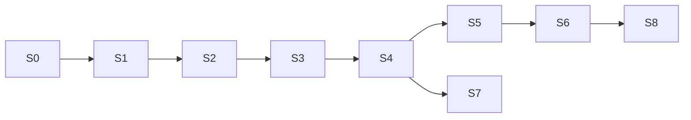

# Business module — implementation backlog and Phase 6B prerequisites

**Status: PROPOSED — Draft for owner review. Nothing here is authorized to start.** Phase 6A, 24 November 2026. Per AGENTS.md, each item is one independently testable task, reuses existing implementations, avoids deferred features and preserves security checks. Sizes are **relative** (S/M/L) and are not time estimates; no capacity or schedule is claimed. Slice names match the [decision register](../../architecture/business/BIZ-Owner_Decision_Register_PROPOSED.md) and [dependency diagram](../../architecture/business/BIZ-Dependencies_PROPOSED.md).

## 1. Phase 6B prerequisites (must be true before any code)

| ID | Prerequisite | Owner action | Blocks |
| --- | --- | --- | --- |
| P6B-01 | Design package approved through a DOC-023 change request: requirements promoted, ADR-BIZ-001 approved or amended, DEC-001 interpretation amended to allow R2 work (DR-BZ-01, DR-BZ-02) | Approve or amend | everything |
| P6B-02 | Decisions for S1 and S2 recorded: DR-BZ-03, 09, 10, 11, 21, 22, 24 | Decide | S2 |
| P6B-03 | Contract approach confirmed: approved operations merged into DOC-205 so the route-contract test covers them (or a documented sibling contract with the same test) | Confirm | S1 |
| P6B-04 | **Purpose-bound step-up proof in Identity** designed and approved: Identity's reauthentication token is bound to account and session and can be consumed only inside Identity; Business needs a way to require a fresh proof for a named purpose without learning credentials | Design review (Identity change) | contact change, closure, transfer, staff removal |
| P6B-05 | Privacy orchestration path for export and erase agreed, or the scope of S5/S6 limited so uncovered categories are not enabled (DR-BZ-18) | Decide | S5, S6 |
| P6B-06 | Database privilege model for a new service agreed: migration owner separate from runtime login from the start; status of R-01 (26 owned tables) known | Confirm | first staging rollout |
| P6B-07 | Figma designs for the Flutter Business screens approved and a route space agreed (DR-BZ-27); DR-BZ-21 is **decided** (mobile only; no public website or business portal); the console stays admin-only | Approve designs | client slices C1–C3 |
| P6B-08 | Legal review scheduled and its owner named (DR-BZ-23) | Name reviewer | S3, S6 |
| P6B-09 | Tracker row B-19 split into per-slice rows with their gates | Approve edit | tracking |

## 2. Slice plan

Public read-only discovery (S4) precedes inquiries and reviews so the least abusable feature ships first. S5 and S6 can be reordered by the owner. S7 waits for the creator-photo pipeline. S8 holds staff, transfer, disputes and service catalog.

### S0 — Governance (no code)

| ID | Item | Size | Depends | Done when |
| --- | --- | --- | --- | --- |
| BZ-B-000 | Raise CR (DOC-023 template) for the Business module; record owner decisions DR-BZ-01/02/24 against exact revisions; update DOC-207 logs, the document register row DOC-020 and tracker B-19 only after approval | S | Phase 6A | Owner decision links recorded; no policy inferred |

### S1 — Foundation (dark, no business behaviour)

| ID | Item | Size | Depends | Acceptance |
| --- | --- | --- | --- | --- |
| BZ-B-001 | Service skeleton `services/business` mirroring existing services (settings, urls, health, probe, tests); no domain tables | S | P6B-01 | health test; structure check lists the new service |
| BZ-B-002 | Infra definitions: schema and role entry in `schema_isolation.sql`, isolation preflight coverage, local run profile, image and stack definition **as files only**; no AWS or staging change | M | P6B-06 | AC-ISO-001, AC-OPS-004 |
| BZ-B-003 | Gateway route module and capability flags (all closed); local settings only | S | BZ-B-001 | AC-AZ-006, AC-OPS-001 |
| BZ-B-004 | Audit: `business` producer, kinds, subject types, read-grant producer list (Audit migration) with tests | S | BZ-B-001 | AC-AUD-001/002; Audit suite passes |
| BZ-B-005 | Contract: add S2 operations to DOC-205; extend the route-contract and role-matrix tests; add a matrix-driven test harness that reads the authorization matrix | M | P6B-03 | AC-CON-001/002 |
| BZ-B-006 | Service identity: verifier and signer copy in `business`, `CALLER_PATHS`, key configuration; update drift test | S | BZ-B-001 | AC-OPS-003, BZ-NT-15 |

### S2 — Registration, membership, profiles and hours (owner-only, nothing public)

| ID | Item | Size | Depends | Acceptance |
| --- | --- | --- | --- | --- |
| BZ-B-010 | First migration and models: `business`, `business_membership`, `business_category`, `profile_revision`, `contact_channel`, `hours_rule`, `hours_exception`, audit outbox, throttle | M | S1, P6B-02 | AC-ISO-002 |
| BZ-B-011 | `authz.py` single entitlement module and its matrix tests | M | BZ-B-010 | AC-AZ-001…005 |
| BZ-B-012 | Registration, owner read, one-owner invariant, closure | M | BZ-B-011 | AC-REG-001…006 |
| BZ-B-013 | Categories (admin create/update, active filter) | S | BZ-B-010 | AC-PRO-002 |
| BZ-B-014 | Profile revisions: edit, submit, validation, banned fields | M | BZ-B-011 | AC-PRO-001/003/007 |
| BZ-B-015 | Hours and exceptions with “open now” computation | S | BZ-B-011 | AC-PRO-004/005 |
| BZ-B-016 | Throttle and idempotency helpers; abuse parameters configuration | S | BZ-B-010 | AC-ABU-001/003 |
| BZ-B-017 | Audit events for every S2 state change | S | BZ-B-004 | AC-AUD-001/002 |
| BZ-B-018 | Gateway routes and exact response validators for S2 | M | BZ-B-003, 005 | AC-CON-002 |
| BZ-B-019 | Owner client screens (mobile) | L | P6B-07 | per client acceptance; no new business logic in the client |
| BZ-B-019a | Step-up for contact change | M | P6B-04 | AC-PRO-006 |

### S3 — Verification and reviewer tooling

| ID | Item | Size | Depends | Acceptance |
| --- | --- | --- | --- | --- |
| BZ-B-020 | `reviewer_grant` model, administrator grant routes | M | S2, DR-BZ-07 | AC-VER-003 |
| BZ-B-021 | Verification case, state machine, decisions, idempotency | L | DR-BZ-04 | AC-VER-001/005/006 |
| BZ-B-022 | Reviewer queue and decision routes through the Gateway; admin-console pages (existing console only) | L | BZ-B-021 | AC-AZ-007, AC-VER-004/007 |
| BZ-B-023 | Duplicate and look-alike detection | M | BZ-B-021 | AC-REG-006 |
| BZ-B-024 | Suspension and restoration with notice and distinct restorer | M | DR-BZ-25 | AC-MOD-003 |
| BZ-B-025 | Evidence upload and reviewer read grants (private R2, quarantine) | L | DR-BZ-19, OD-07 | AC-UPL-001…004, AC-VER-008 |
| BZ-B-026 | Business appeals | M | DR-BZ-25 | AC-MOD-004 |

### S4 — Listings, discovery and search (read-only public)

| ID | Item | Size | Depends | Acceptance |
| --- | --- | --- | --- | --- |
| BZ-B-030 | `business_listing` projection, eligibility predicate, reconciliation report | M | S3, DR-BZ-05 | AC-DIS-001/005/008 |
| BZ-B-031 | Full-text and trigram indexes, search with filters, keyset cursor | L | BZ-B-030, DR-BZ-13 | AC-DIS-002/003/006/007 |
| BZ-B-032 | Public routes, contact reveal and throttles, gateway validators | M | BZ-B-031, DR-BZ-12 | AC-DIS-004, AC-ABU-004 |
| BZ-B-033 | Customer discovery client (mobile) | L | P6B-07 | client acceptance |

### S5 — Customer inquiries

| ID | Item | Size | Depends | Acceptance |
| --- | --- | --- | --- | --- |
| BZ-B-034 | Inquiry models and routes (customer and owner), blocks, throttles | L | S4, DR-BZ-14, P6B-05 | AC-INQ-001…007 |
| BZ-B-035 | Reporting of inquiry messages | S | DR-BZ-17 | AC-MOD-001 |
| BZ-B-036 | Customer and owner inquiry client screens | L | P6B-07 | client acceptance |

### S6 — Reviews and moderation

| ID | Item | Size | Depends | Acceptance |
| --- | --- | --- | --- | --- |
| BZ-B-040 | Moderation generalization: subject types and decision-application port (additive, separately approved) | L | DR-BZ-17 | Moderation suite unchanged for videos; AC-MOD-005 |
| BZ-B-041 | Review models, eligibility, aggregates (transactional), withdrawal/edit | L | DR-BZ-15, 16 | AC-REV-001…003, 009 |
| BZ-B-042 | Fraud holds and velocity signals (reason codes only) | M | BZ-B-041, DR-BZ-22 | AC-REV-004/005 |
| BZ-B-043 | Owner responses, reports, appeals | M | BZ-B-041 | AC-REV-006/007, AC-MOD-001/002/004 |
| BZ-B-044 | Review client screens | L | P6B-07 | client acceptance |

### S7 — Images (only after the shared image pipeline exists)

| ID | Item | Size | Depends | Acceptance |
| --- | --- | --- | --- | --- |
| BZ-B-045 | Business logo and photos via the shared pipeline with pre-moderation | L | DR-BZ-20, D-10 pipeline | AC-UPL-001…004 |

### S8 — Staff, transfer, disputes, services

| ID | Item | Size | Depends | Acceptance |
| --- | --- | --- | --- | --- |
| BZ-B-046 | Staff invitation and removal; staff capability enforcement | L | DR-BZ-08, P6B-04 | NT-03, AC-PRO-005 |
| BZ-B-047 | Ownership transfer and ownership disputes | L | DR-BZ-08, 26 | AC-VER-009 |
| BZ-B-048 | Claim of seeded listings | M | DR-BZ-06 | per policy |
| BZ-B-049 | Services catalog | M | owner request | per policy |

### Client slices (DR-BZ-21: Flutter for owners, staff and customers; console for moderators and administrators)

Added in Phase 6A reconciliation. Each item reuses the existing client or console infrastructure ([client architecture](../../architecture/business/BIZ-Client_Architecture_DR-BZ-21.md)); none is authorized to start without approved designs (DR-BZ-27) and, for any link, DR-BZ-28. The older client items BZ-B-019, 033, 036 and 044 are the same work and are superseded by the slices below.

| ID | Item | Size | Depends | Acceptance |
| --- | --- | --- | --- | --- |
| BZ-C-000 | Repository guards for the client decision: no HTML, CORS, cookies or templates on Business routes; console Business routes registered as privileged | S | none (backend exists) | AC-CLI-001…004 |
| BZ-C-001 | Extend the Flutter route space and design audit for Business screens (approved numbering) | M | DR-BZ-27 | design audit passes with the new screens |
| BZ-C-010 | Customer discovery: directory, filters, detail, published reviews, report sheet | L | BZ-C-001 | AC-CLI-006/007, AC-DIS-004 |
| BZ-C-011 | Customer inquiries: start, list, thread, close, confirm | L | BZ-C-010 | AC-CLI-006/007 |
| BZ-C-012 | Customer reviews: write (basis shown), my reviews, edit, withdraw | L | BZ-C-010 | AC-CLI-006/007 |
| BZ-C-020 | Owner onboarding: register, my businesses, verification submit, answer request, status | L | BZ-C-001, DR-BZ-10 lists | AC-CLI-006/007 |
| BZ-C-021 | Owner profile and listing: editor with public toggles, hours, submit, publish/unpublish; contact change only after step-up | L | BZ-C-020, P6B-04 | AC-CLI-006/007, AC-PRO-006 |
| BZ-C-022 | Staff management: team, invite, redeem, leave, remove (after step-up) | L | BZ-C-020, P6B-04 | AC-CLI-006/008 |
| BZ-C-023 | Owner and staff inbox; review responses; review-invitation codes | L | BZ-C-020 | AC-CLI-006/007/008 |
| BZ-C-030 | Console: verification queue and case; profile-revision review | L | none (backend exists) | AC-CLI-005 |
| BZ-C-031 | Console: business-report review; reviewer grants; registration grants; categories | L | BZ-C-030 | AC-CLI-005 |
| BZ-C-032 | Console: suspension and restoration | M | DR-BZ-25 and its backend | AC-CLI-005, AC-MOD-003 |

### Cross-cutting

| ID | Item | Size | Depends | Acceptance |
| --- | --- | --- | --- | --- |
| BZ-B-050 | Retention jobs, gated on approved rules, with report of categories lacking rules | M | DR-BZ-18 | AC-PRV-002/003 |
| BZ-B-051 | Privacy export and erase operations | M | P6B-05 | AC-PRV-004 |
| BZ-B-052 | Security verification: run all BZ-NT cases; mutation checks (removing a membership check must fail the matrix); record evidence | M | each slice | evidence note per slice |
| BZ-B-053 | Merge threat rows into DOC-203 and controls into DOC-206 after approval | S | owner approval | register consistency |
| BZ-B-054 | Operations: monitoring, alerting, kill-switch procedure, runbook entry | M | ADR-017 | operator-run evidence |
| BZ-B-055 | Tracker and documentation updates per slice | S | each slice | tracker rows reflect actual state |

## 3. Pull request plan for Phase 6B

One PR per backlog item or a tight pair (for example BZ-B-010 with BZ-B-011), each independently testable and reviewable; no PR merges automatically; Phase 6B items do not start before the prerequisites above. Each PR reports actual changes, tests and results, failures, the PR link and unresolved work, and links the acceptance IDs it covers.

## 4. Release gating (unchanged by this plan)

Production remains NO-GO. No Business capability is enabled on staging or production by any slice; enabling is a separate owner-approved release record that names the flags, the evidence and the open decisions resolved. The R1 gates ([go-live readiness](../../planning/go_live_readiness.md)) are not weakened.

## 5. Known repository facts that affect the plan

- `scripts/check_structure.py` hard-codes eight services and must be extended in BZ-B-002.
- The shared service-identity verifier is duplicated per service by design and guarded by a drift test; the new copy must be added to that test (BZ-B-006).
- The Audit service's read-grant model has a producer check constraint; adding `business` is a migration in the Audit service (BZ-B-004).
- Moderation's `Report`, `ModerationAction` and `Appeal` are keyed on `video_id`; any reuse is a deliberate, separately approved change (BZ-B-040).
- Identity's reauthentication token is consumable only inside Identity (P6B-04).
- The R1 web console is for moderators and administrators only. **DR-BZ-21 is decided: business owners, staff and customers use Flutter and there is no public website or business web portal.** No Business screen or console page exists yet (BZ-C slices).
- Business has no analogue of the creator-photo pipeline; D-10 is written but disabled.
