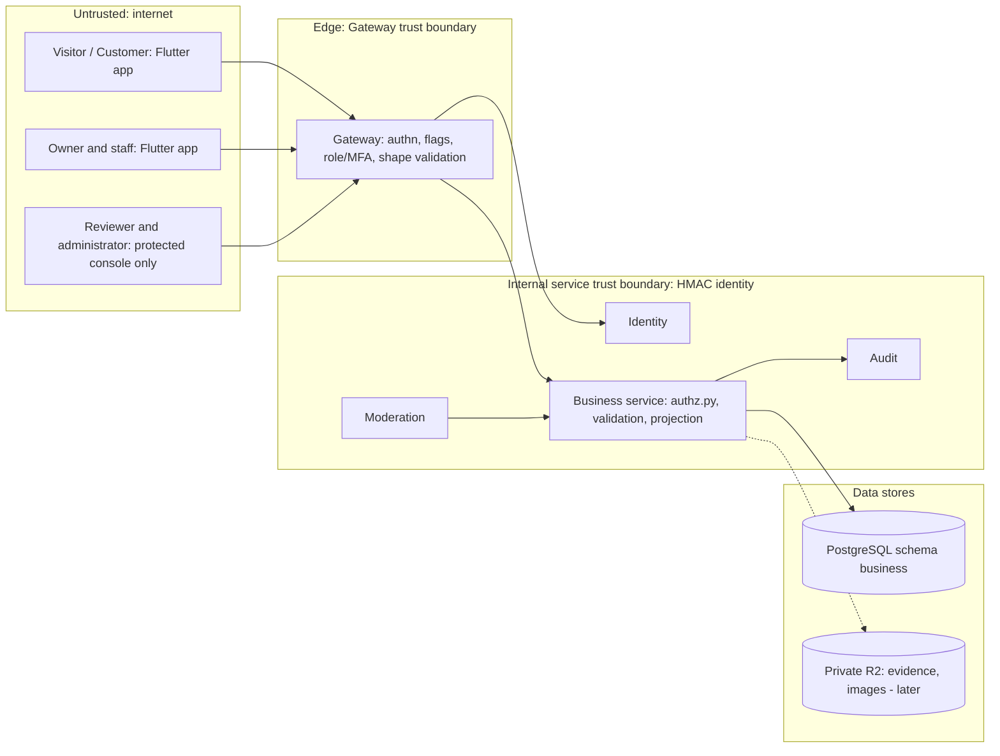

# Business module — STRIDE threat model

**Status: PROPOSED design-stage model. No control below is implemented or tested.** Phase 6A, 24 November 2026. Follows the conventions of [DOC-203](../../architecture/DOC-203_STRIDE_Risk_Register.csv): inherent severity before controls, required controls, verification, residual severity “TBD after implementation”, status “Proposed / not tested”. This is design-time self-assessment, **not** independent security assurance. Threat details here are design-level; do not add secrets, personal data or exploit specifics.

> **Status update, 24 November 2026 (Phase 6A reconciliation).** This is supporting design for decisions the owner approved as written (DR-BZ-01…26, [approval record](../../architecture/business/BIZ-Owner_Approval_Record_2026-11-24.md)); no separate approval of this document is recorded, and the banner above is the original wording. DR-BZ-21 was decided formally (Flutter only; no public website or business portal). The backend was built in Phase 6B (PR #219, closed flags, **not deployed**; production NO-GO). Where this document and the as-built system differ, see the [architecture validation](../../architecture/business/BIZ-Architecture_Validation_PHASE6A.md); what the owner must still decide is in [owner decisions required](../../architecture/business/BIZ-Owner_Decisions_Required_PHASE6A.md).

After approval, rows should be merged into DOC-203 and the verification columns into DOC-206; this file does not edit either register.

## 1. Scope, assets and adversaries

**Assets.** Verification trust (the “verified” claim); business identity and ownership; public listing integrity; customer and reviewer personal data (account ids, inquiry text, review text); verification evidence; reviewer authority; availability of search; audit integrity.

**Adversaries.** Anonymous scraper; spammer; impersonator of a real business; fraudulent or competing business owner; disgruntled customer; paid review farm; malicious staff member; compromised owner account; malicious or colluding reviewer (insider); network attacker between services; curious operator.

**Out of scope here.** Payment, ticket and advertising threats (features excluded); infrastructure threats already in DOC-203 (perimeter, Swarm, PostgreSQL topology) apart from how this module changes them.

## 2. Data-flow diagram and trust boundaries

| Boundary | Crossing | Main concerns |
| --- | --- | --- |
| Internet → Gateway | Public and authenticated requests | Spoofing, scraping, injection, DoS, enumeration |
| Gateway → Business | Signed envelope | Forged callers, confused deputy (gateway passes wrong actor), replay |
| Moderation → Business | Decision application | Forged decisions, replay |
| Business → PostgreSQL | Queries | Cross-business reads (BOLA), SQL/FTS injection, over-broad grants |
| Business → R2 (later) | Evidence, images | Public exposure, malicious files, leaked evidence |
| Business → Audit | Outbox delivery | Lost or forged evidence, PII in events |

## 3. Threat register

Severity is the proposed inherent severity (Critical, High, Medium, Low). “Req” cites [BZ-R](../../requirements/DOC-020_Business_Requirements_and_Scope_PROPOSED.md); “Tests” cites [BZ-NT](BIZ-RBAC_and_Object_Authorization_Matrix_PROPOSED.md) negative tests and [acceptance criteria](../../engineering/phase6/BIZ-Acceptance_Criteria_PROPOSED.md). All rows: residual “TBD after implementation”, status “Proposed / not tested”.

### 3.1 Object-level authorization (IDOR / BOLA)

| ID | S T R I D E | Threat | Scenario | Sev | Required controls | Req | Tests |
| --- | --- | --- | --- | --- | --- | --- | --- |
| BZ-T-001 | E, I | Cross-business read or write via guessable or swapped business id | Owner of A replays B's id on `/me/businesses/{id}` routes to read legal name, inbox or edit profile | Critical | Membership resolved for the path id on every request in `authz.py`; query scoped by authorized id; 404 on non-entitlement; UUID ids; one-module rule enforced by a test | 033, 034 | NT-01, AC-AZ-001 |
| BZ-T-002 | E, I | Nested-id confusion | A's owner supplies a thread, review or member id from B under A's path | Critical | Every nested object must carry `business_id = path id`; join, not fetch-then-check | 033, 034 | NT-02, NT-19 |
| BZ-T-003 | I | Customer reads another customer's thread or review | Sequential or leaked thread id used with own session | High | Thread and review queries scoped by `actor`; 404 | 033, 034 | NT-05, NT-06 |
| BZ-T-004 | E | Mass assignment of authority | Body carries `role`, `state`, `verified`, `listed`, `account_id` | Critical | Allowlist schemas; unknown fields 400; banned-field tests; server derives all of them | 043 | NT-09 |
| BZ-T-005 | E | Stale authority after revocation | Removed staff keeps using a token or cached grant | High | Per-request membership and grant lookup; no authority in tokens or caches | 035 | NT-04 |
| BZ-T-006 | E | Privileged account acts as owner or staff | Moderator registers a business and verifies it | High | Refuse memberships for moderator/administrator; reviewer ≠ submitter and not affiliated | 005, 037 | NT-08, NT-11 |
| BZ-T-007 | E | Last-owner race or takeover | Concurrent removals leave no owner, or an invited staff member is promoted | High | Transactional invariant with row lock; role never taken from body; promotion only via transfer with step-up | 002, 036 | NT-10 |
| BZ-T-008 | S, E | Confused-deputy through the Gateway | Gateway forwards a wrong `actor_id` (code defect) | High | Service-side independence: service never accepts an owner id from the body; gateway tests assert actor binding; per-caller keys | 033, 047 | NT-15, AC-AZ-004 |

### 3.2 Impersonation and verification abuse

| ID | S T R I D E | Threat | Scenario | Sev | Required controls | Req | Tests |
| --- | --- | --- | --- | --- | --- | --- | --- |
| BZ-T-010 | S | Business impersonation | Attacker registers a well-known or look-alike name, hoping to be verified or to deceive customers | High | Verification gate before any public listing (DR-BZ-05); duplicate and look-alike flags at submission; protected-name review; ownership dispute and takedown path; “verified” shown only from reviewer decision | 003, 004, 006, 008 | AC-VER-001…004 |
| BZ-T-011 | S, R | Forged or reused verification evidence | Doctored documents or someone else's proof | High | Reviewer evidence checklist (owner policy); evidence stored hashed and immutable after submission; resubmission limits; contact-channel proof of control where policy adopts it; decisions audited | 004, 045 | AC-VER-005 |
| BZ-T-012 | T | Verification state tampering | Attacker (or buggy path) flips `verified`, or reuses an old approved case after material change | High | State machine in one function; verified requires a decision row; material-change handling (DR-BZ-11) | 004, 006, 007 | AC-VER-006 |
| BZ-T-013 | E, R | Reviewer collusion or insider approval | Reviewer approves own or friend's business; bulk approval | High | SoD checks; explicit scoped grants; MFA; per-decision audit with reason code; periodic grant review; anomaly report on one reviewer's approvals | 005, 044 | NT-11, AC-VER-007 |
| BZ-T-014 | D | Verification queue flooding | Mass fake submissions to delay review | Medium | Per-account cap; one open case; throttle; account-age gate (DR-BZ-22) | 042 | AC-ABU-002 |
| BZ-T-015 | S | Account takeover of an owner, then hijack listing | Compromised session edits phone number to scam customers | High | Step-up for contact change, ownership transfer, staff removal (P6B-04); owner notification; cooling-off on contact change per policy; session revocation reuses Identity | 007, 036 | AC-PRO-006 |
| BZ-T-016 | S | Ownership dispute abuse | A rival files a false dispute to freeze a listing | Medium | Dispute needs verified account and reason code; adjudication by administrator with MFA; abuse threshold; audited | 008 | AC-VER-009 |
| BZ-T-017 | I | Evidence disclosure | Reviewer without grant, leaked URL, or logs expose documents | Critical | Private bucket; short-lived single-use signed reads; evidence-scope grant; each issue audited; ids-only logs; retention/purge per DR-BZ-18 | 041, 045 | NT-22, AC-VER-008 |

### 3.3 Unauthorized profile changes and listing integrity

| ID | S T R I D E | Threat | Scenario | Sev | Required controls | Req | Tests |
| --- | --- | --- | --- | --- | --- | --- | --- |
| BZ-T-020 | T | Unapproved material change reaches the public | Owner edits name or category after verification to mislead | High | Revisions; public = last approved; re-review rules (DR-BZ-11) | 007, 010 | AC-PRO-003 |
| BZ-T-021 | T | Malicious content in fields | Script or markup in names, descriptions, hours; unsafe URL scheme | Medium | Plain text only; length and character allowlist; websites `https` only; clients render text; admin console escapes (Django templates) | 012, 015 | AC-PRO-001 |
| BZ-T-022 | T, I | Private data leaks into public view | Query joins private tables; serializer includes `legal_name`, private contacts | High | Public reads only from `business_listing`; column-allowlist test; gateway response allowlists | 016, 019 | NT-14 |
| BZ-T-023 | T | Search poisoning and keyword stuffing | Owner packs the description with competitor names or popular terms | Medium | Bounded text; ranking rules documented and versioned; no owner-controlled boost; reports; moderation sampling | 017 | AC-DIS-006 |
| BZ-T-024 | R | Disputed changes | Owner denies changing a number; staff denies change | Medium | Audit per change with actor id and revision; revision history | 044 | AC-AUD-001 |
| BZ-T-025 | I | Takedown not effective | Cached or projected data persists after suspension | Medium | Projection updated in the same transaction; reconciliation report; cache TTL cap (BZ-R-020) | 020 | NT-13, AC-DIS-005 |
| BZ-T-026 | E | Staff exceeds delegated scope | Staff edits profile, blocks customers, removes owners | High | Staff capability set fixed in `authz.py`; matrix tests per operation | 033, 041 | NT-03 |

### 3.4 Discovery and search

| ID | S T R I D E | Threat | Scenario | Sev | Required controls | Req | Tests |
| --- | --- | --- | --- | --- | --- | --- | --- |
| BZ-T-030 | I | Bulk scraping of contact data | Harvest phone numbers and emails for spam or fraud | High | Anonymous access limited to minimal fields; contacts to signed-in accounts under a reveal budget (DR-BZ-12); throttles by account and address; page-size cap; opaque cursors; no sequential ids | 018, 019, 042 | AC-DIS-004 |
| BZ-T-031 | T | SQL or full-text query injection | Crafted `q` abuses tsquery operators or concatenated SQL | High | Bound parameters; safe parser (`websearch_to_tsquery`/`plainto_tsquery`); length and character limits; unknown filters 400 | 018, 043 | AC-DIS-003 |
| BZ-T-032 | D | Expensive queries | Wildcard-heavy or very broad searches, deep pagination | Medium | Statement timeout; page cap; keyset pagination; indexes; throttles | 018, 042 | AC-DIS-007 |
| BZ-T-033 | T | Cursor forgery | Client crafts a cursor to read other positions or probe ordering | Low | HMAC-authenticated opaque cursor; invalid → 400 | 018 | NT-16 |
| BZ-T-034 | I | Enumeration of unlisted businesses | Probe ids or names to learn which exist | Medium | Same 404 for unlisted, suspended and unknown; no differential timing in the common path; UUID ids | 034 | NT-13 |
| BZ-T-035 | D | Search and public endpoints abused to starve sign-in or video | Load on the shared database or gateway | Medium | Separate service and schema; per-route throttles at gateway; capability flag off switch; bulkhead timeouts | 046, 047 | AC-OPS-002 |

### 3.5 Customer inquiries

| ID | S T R I D E | Threat | Scenario | Sev | Required controls | Req | Tests |
| --- | --- | --- | --- | --- | --- | --- | --- |
| BZ-T-040 | D | Inquiry spam to businesses | Scripted accounts flood a business or all businesses | High | Verified email; per-customer, per-business, global budgets; account-age gate; one open thread per pair; report path; business block | 021, 024, 042 | AC-INQ-003 |
| BZ-T-041 | I | Customer identity exposed to the business | Business learns account id, email or other threads | High | Business sees `customer_label` only; no account id in any payload; no contact fields in inquiry schema; message text is the customer's choice | 023 | AC-INQ-002 |
| BZ-T-042 | T | Harassment of customers by a business | Repeated unsolicited messages after a thread is closed | Medium | Business can only reply in customer-opened open threads; cannot start threads; rate limit; report; moderator action on business | 022, 025 | AC-INQ-005 |
| BZ-T-043 | T | Malicious links or content in messages | Phishing links, malware names, abuse | Medium | Plain text; no attachments; link policy per DR-BZ-14; report; moderator removal | 015, 022 | AC-INQ-004 |
| BZ-T-044 | I | Message disclosure through logs or notifications | Message body appears in logs, audit or push | Medium | ids-only logs and audit; no notification content in first release | 041 | AC-AUD-002 |
| BZ-T-045 | R | Disputed message content | Party denies a message | Low | Immutable message rows with timestamps; removal is a state, not a delete, subject to retention | 022 | AC-INQ-006 |

### 3.6 Reviews

| ID | S T R I D E | Threat | Scenario | Sev | Required controls | Req | Tests |
| --- | --- | --- | --- | --- | --- | --- | --- |
| BZ-T-050 | S, T | Fake positive reviews by owner or associates | Owner, staff, relatives and employees post five-star reviews | High | Block members and affiliated accounts; eligibility basis stored and shown (DR-BZ-15); velocity and new-account holds; reviewer anomaly checks; basis-labelled display | 026, 027, 028 | NT-07, AC-REV-002 |
| BZ-T-051 | S, T | Competitor review bombing | A rival coordinates one-star reviews | High | Eligibility policy; velocity per business and per author; hold on spikes; reports; moderator tooling for bulk action; business can report but not delete | 026, 028, 032 | AC-REV-004 |
| BZ-T-052 | T | Paid review farms and sock puppets | Many accounts post template reviews for money | High | Account-age and verification gates; rate limits per account; similarity heuristics (content only; no device fingerprinting without approval); hold and review; audit | 026, 028, 042 | AC-REV-005 |
| BZ-T-053 | T | Extortion with the threat of a bad review | “Pay or I post” by an author, or review removal for money by a business | Medium | Report path for coercion; business cannot remove; removal only by moderators with reason code; appeals | 029, 032 | AC-REV-007 |
| BZ-T-054 | I | Retaliation and doxxing of reviewers | Business response reveals author identity; review contains personal data | High | Author id never exposed; response moderation; personal-data report reason; author-label policy (DR-BZ-16) | 029, 032 | AC-REV-006 |
| BZ-T-055 | T | Rating manipulation | Direct write to aggregates; edit-after-publish to flip meaning | High | Aggregates server-computed in the same transaction; edits re-enter checks; edit history per policy | 030, 031 | AC-REV-003 |
| BZ-T-056 | R | Moderator abuse or inconsistency | Removal or restoration for favours; no reasons | High | Reason codes; MFA; grants; restoration by different reviewer; appeal; audit; sampling review | 032, 044 | NT-20, AC-MOD-003 |
| BZ-T-057 | D | Review flooding on one business | Mass submissions degrade moderation | Medium | Velocity holds; throttles; queue prioritization | 042 | AC-REV-008 |
| BZ-T-058 | I | Defamatory or unlawful content | Review contains allegations or personal data | High | Report reasons; takedown workflow and legal review (DR-BZ-23); retention of removed text only as policy allows | 032, 039 | AC-MOD-004 |

### 3.7 Platform, data and operations

| ID | S T R I D E | Threat | Scenario | Sev | Required controls | Req | Tests |
| --- | --- | --- | --- | --- | --- | --- | --- |
| BZ-T-060 | S | Forged or replayed internal call | Attacker or compromised service calls Business directly | High | HMAC per-caller keys, audience binding, 60 s window, DB nonce table, per-caller path allowlist; network isolation | 047 | NT-15 |
| BZ-T-061 | I | Cross-service data access | Another service or an operator reads Business tables | High | Schema and role isolation; no cross-schema grants; UUID refs only; verify with the isolation preflight; avoid the R-01 pattern (separate migration owner) | 047 | AC-ISO-001 |
| BZ-T-062 | R | Missing or forged audit trail | Events lost, altered or contain personal data | High | Local outbox with retry; Audit ingest idempotent by id and digest; producer and kind allowlists; payload ids only | 041, 044 | AC-AUD-001, AC-AUD-002 |
| BZ-T-063 | I | Personal data retained or exposed beyond need | Evidence, messages, removed reviews kept indefinitely | High | Categories and mechanisms now; periods only after approval (DR-BZ-18); legal hold; purge jobs bounded and tested | 038, 039, 040 | AC-PRV-001…004 |
| BZ-T-064 | T | Malicious upload (when enabled) | Polyglot, oversized or decompression-bomb image; malware as evidence | High | Size-bound create-only private upload; decode and re-encode; strip metadata; quarantine state; no execution; worker sandbox | 045 | AC-UPL-001…004 |
| BZ-T-065 | E | Flag mistakes expose unfinished routes | A capability flag misconfigured on staging or production | High | Flags default closed; route-contract test; staging allowlist reviewed; production unauthorized | 046, 048 | NT-23, AC-OPS-001 |
| BZ-T-066 | D | Database or gateway overload from Business | Hot queries slow other services | Medium | Own schema and login; statement timeouts; indexes; connection caps; kill switch via flag | 046, 047 | AC-OPS-002 |
| BZ-T-067 | T | Supply chain | New dependency (search extension, image library) introduces vulnerabilities | Medium | Prefer built-in PostgreSQL features; pinned, scanned dependencies through existing CI; no new vendor | 047 | AC-OPS-003 |
| BZ-T-068 | I | Reviewer or operator over-collection | Support copies data into tickets or chat | Medium | Privileged-read audit; no export features in first release; operator procedures in a later runbook | 041, 044 | AC-AUD-003 |

### 3.8 Client surfaces (added for DR-BZ-21, 24 November 2026)

The owner decided that all business owners, staff and customers use Flutter and that there is no public website or business web portal. These rows cover what that decision changes. Severity is proposed inherent severity.

| ID | S T R I D E | Threat | Scenario | Sev | Required controls | Req | Tests |
| --- | --- | --- | --- | --- | --- | --- | --- |
| BZ-T-070 | E, S | A web surface is added by drift | A developer adds CORS, a template, a cookie session or a public page "just for sharing"; browser attack classes and a second client appear unreviewed | High | Gateway and Business define no templates, CORS or cookie handling and a test keeps it so; route-contract and console route matrices fail on an unclassified route; owner approval (DR-BZ-21, 28) is the only way to change it | 049, 050, 051 | AC-CLI-001…004 |
| BZ-T-071 | S, E | Lost, stolen or rooted device used to take over an owner account | Refresh token extracted; attacker edits contacts, removes staff, answers reviews | High | Existing short access token (300 s), rotation with replay revocation, session list and revoke; step-up for contact change, staff removal, closure and transfer (P6B-04, **not yet built; these actions refuse today**); audit of every change | 036 | NT-04, AC-PRO-006 |
| BZ-T-072 | T, E | Tampered or custom client asserts authority | Modified app or script sends owner, role, state, eligibility, rating or "open now" | High | Server derives all authority; banned-field rejection (400); exact request allowlists; the client holds no logic that the server does not repeat | 033, 043, 053 | NT-09, AC-CLI-007 |
| BZ-T-073 | I | Directory scraped with plain scripts | No website does not mean no scraper: the anonymous API is callable by any HTTP client | High | Minimal anonymous fields; contact channels only to signed-in verified accounts with a reveal budget; per-IP and per-account throttles at the edge and gateway; bounded pages; keyed cursors | 019, 042 | NT-16, AC-DIS-004, AC-ABU-004 |
| BZ-T-074 | S, I | Share or deep link used for phishing or to expose a business | A link outside the app resolves to a page or to a spoofed app link | Medium | No external link or share page until DR-BZ-28 is decided; if app links are later approved, they carry only a business id and require sign-in rules to apply | 049, 054 | AC-CLI-004 |
| BZ-T-075 | I | Single-use code leaks from the device | Staff invitation or review-invitation code captured by screenshot, clipboard, logs or storage | Medium | Code shown once, not persisted, not logged; 72-hour expiry for staff codes; single use under concurrency; only a keyed digest stored server-side; revocation | 054 | AC-CLI-008, B1 and B5 tests |
| BZ-T-076 | T, I | Business text attacks the reviewer console | Script or markup in a name, review or evidence note renders in a reviewer's browser | High | Plain text everywhere (BZ-R-015); the console escapes all Business text (template auto-escape, tested with hostile strings); `no-store`; short session | 015, 050 | AC-CLI-005 |
| BZ-T-077 | D, T | Old app versions break or misuse a changed contract | Fielded app calls an operation whose meaning changed | Low | Additive-only contract changes; existing `/app/compatibility` gate; responses validated by the client before use | 048 | AC-CON-001 |

## 4. Highest risks and what they depend on

| Risk | Why it is high | Depends on decision |
| --- | --- | --- |
| Impersonation passing verification (BZ-T-010/011) | The verified badge is the trust product | DR-BZ-04, 05, 07, 19, 23 |
| Fraudulent or hostile reviews (BZ-T-050…055) | Reviews have commercial consequences and legal exposure; eligibility rules are undefined | DR-BZ-15, 16, 17, 23 |
| Cross-business access (BZ-T-001…003) | Single defect exposes any business's private data | none: design covers it; tests are mandatory |
| Account takeover then contact change (BZ-T-015) | Fastest path to defrauding customers | P6B-04, DR-BZ-11 |
| Contact scraping (BZ-T-030) | Directory is naturally a scraping target | DR-BZ-12, 22 |
| Evidence disclosure (BZ-T-017) | Sensitive documents | DR-BZ-19, 18 |

## 5. Assumptions and limits

The model assumes the existing gateway, Identity session and service-identity controls hold as described in current code; it does not re-verify them (their own evidence is tracked in the R1 trackers). It assumes TLS between services and secret handling as designed in ADR-013 and the AWS as-built record; the open items there (PostgreSQL role ownership, origin authentication, backup) apply equally to this module. Behavioural fraud detection beyond simple velocity and content signals is not designed; device and network fingerprints are deliberately not collected (data minimization) unless the owner approves a specific, justified signal.
